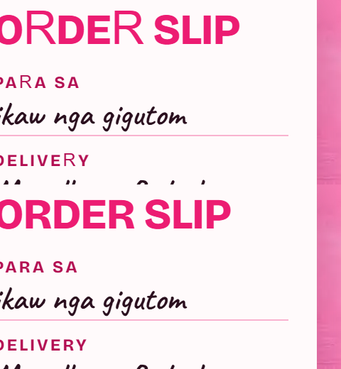

# Bricolage kerning prune — render proof

`site/fonts/bricolage.woff2`: **17,048 B → 12,840 B** (−4,208 B, −24.7%), now including capital J, R, X, Z that the old subset had dropped.

## What changed in the font

| Table | Before | After |
|---|---:|---:|
| `GPOS` (variable `kern`) | 16,188 B | 3,532 B |
| `GDEF` (variation store) | 146 B | 112 B |
| `glyf`, `gvar`, `hmtx`, `cmap` | 94 glyphs / 80 codepoints | 98 glyphs / 84 codepoints (+J R X Z); existing 80 outlines identical at wght 400/550/650/750/800 |

1,043 glyph pairs occur in page text (including `tnum` digit forms); 487 of them carry kerning and are kept with their original values and variation deltas.

## Rendered-pixel proof

```
node tool/kern_pairs.mjs
python tool/prune_kerning.py
node tool/font_render_diff.mjs site tool/fonts/bricolage-source.woff2 site/fonts/bricolage.woff2 <out>
python tool/png_diff.py <out>
```

Headless Chrome, full-page, animations off, iframes hidden, `content-visibility` forced visible, font confirmed `loaded`:

| Page | Width | Size (px) | Differing pixels (pruned) | Differing pixels (no-kern control) |
|---|---:|---|---:|---:|
| `/` | 320 @2x | 640×18482 | **0** | page height changed (+42 px) |
| `/` | 390 @2x | 780×17756 | **0** | 271,451 |
| `/` | 768 @2x | 1536×16028 | **0** | 302,522 |
| `/` | 1440 @1x | 1440×5982 | **0** | 105,182 |
| `/menu/` | 320 @2x | 640×11878 | **0** | page height changed (+42 px) |
| `/menu/` | 390 @2x | 780×10642 | **0** | 243,347 |
| `/menu/` | 768 @2x | 1536×9796 | **0** | 265,041 |
| `/menu/` | 1440 @1x | 1440×3565 | **0** | 88,271 |

The control (same font with `GPOS` deleted) proves the diff detects kerning loss; the pruned font renders identically to its source.

## Capital J/R/X/Z restored

The previous source (`6b4eeba`) had no J, R, X, Z, so Chrome drew them in the fallback face. Re-subsetting from `7470e70` adds them; a render of the old source vs the new pruned font changes only those glyphs (129,326 px across 8 renders, page heights unchanged):



The build is deterministic (`recalcTimestamp=False`): three runs give the same SHA-1.

## Guard

`test/site/app.test.mjs` › "the pruned Bricolage kerning covers every character pair the pages render" fails if page copy gains an uncovered pair. Checked by editing the menu heading to add "Wavy Jazz": the guard reports `JA, Ja, VY, …` missing.
