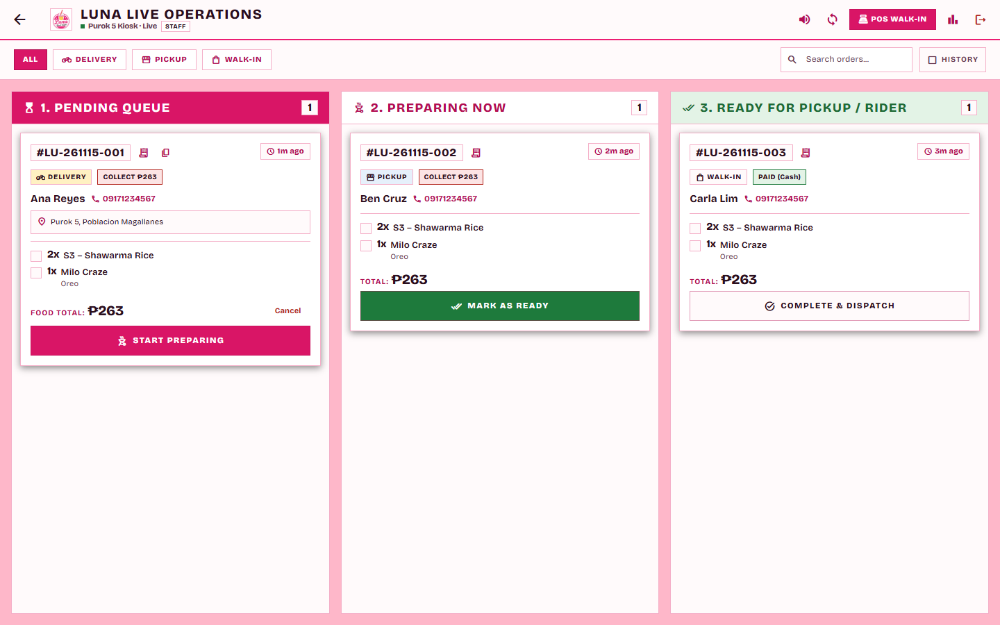
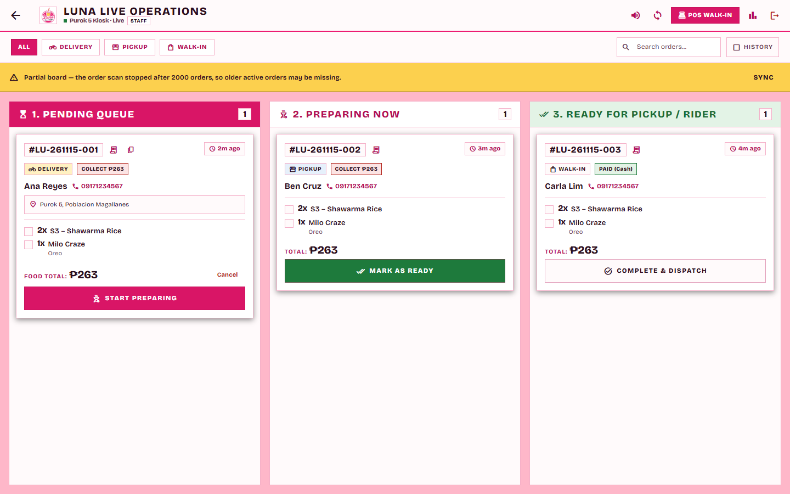
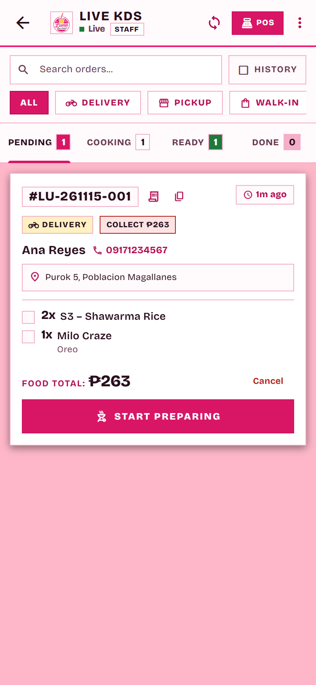
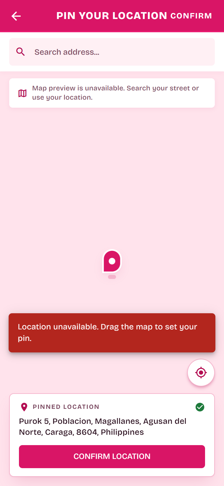
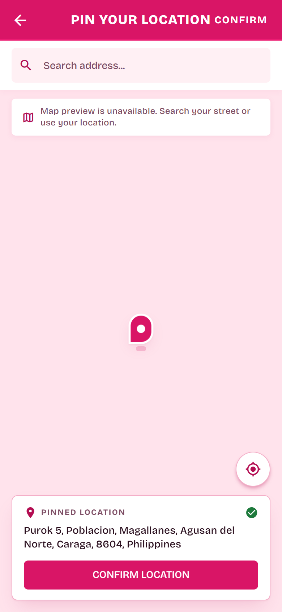

# Hardening pass (c) — performance, reliability, security & bug fixes (2026-11-24)

Scope: a fresh read of `functions/src/**`, `functions/scripts/**`, `app/src/**`, `firebase.json`,
`firestore.rules` / `firestore.indexes.json`, and the build output, looking for defects the
previous passes (`SEC-01…10`, `REL-01…11`, `PERF-01…08`) did not cover. Everything below is
code-only: no `firestore.rules`, no `firestore.indexes.json`, no secret, no deployment.

## Found and fixed

| # | Class | Where | Problem | Fix |
|---|---|---|---|---|
| 1 | Security / data integrity (SEC-11) | `app/src/kiosk/order.ts`, `app/src/kiosk/firebase.ts` | `placeOrder` fell back to a direct `setDoc(orders/{autoId})` + `sendOrderNotification` whenever the callable answered `not-found`/`unimplemented`. That path wrote client-priced, client-dated, unvalidated orders through the still-open create rule, skipping server pricing, the per-IP order rate limit and the idempotency fingerprint. A stale or renamed callable would silently take orders instead of failing. | The fallback, its `orderFields`/`notificationFor` payload builders and the now-unused `firebaseDbLite()` are gone. A missing callable returns `errorCode: 'not-found'` and checkout shows its save-error copy. |
| 2 | Security (SEC-12) | `functions/scripts/reset-staff-credentials.js` | `updateStaffPin` refuses a PIN another account already uses, but the documented reset script did not. PIN sign-in scans `staff_accounts` and signs in as the first match, so a shared PIN can hand a staffer another account's session — including the admin one. | The script verifies the new PIN against every other account's `pinHash` and aborts with `PIN is already used by staff account "…"` before writing anything. |
| 3 | Bug / reliability (REL-12) | `app/src/staff/kds.ts` | `renderAll()` called `renderControls()`, which rewrote `ctl.innerHTML` on every published feed update. Any new order or status change by another tablet re-created the search `<input>` and filter chips, so a staffer filtering the board lost focus and cursor position mid-word. `renderBar()`/`renderBanner()` were already diffed for this exact reason. | The control bar is built once at mount; `renderAll()` now syncs `aria-pressed`, the history glyph (`textContent`, not `outerHTML`) and the clear button in place. |
| 4 | Reliability / observability (REL-13) | `functions/src/orders/kds.ts`, `app/src/staff/kds.ts` | REL-01 added a 2 000-document scan budget that returns `truncated`/`scanned`, but nothing consumed them. When the callable stopped before filling the board, the tablet still showed a partial board as complete — the same silent data loss REL-01 meant to remove, one layer up. | The board stores `truncated`/`scanned` and shows a warning banner naming the scan limit with a SYNC control (which also restarts the live listener if it had fallen back to polling). A later complete scan clears it. |
| 5 | Correctness / standards (REL-14) | `functions/src/orders/kds.ts` | `updateOrderStatus` logged `status updated to X` and returned `{ success: true }` even when `buildStatusUpdate` wrote nothing (order already in that status). Two tablets tapping the same column produced a false log line and a false "Order updated" snackbar, and skipped the resync that would have shown the truth. `CODING_STANDARDS.md` requires caller responses and logs to come from the post-transaction result. | The transaction body is the exported `applyOrderStatus()`, returning `{ changed, previousStatus }`. The callable logs the real transition (or `already X; no write needed`) and returns `changed`; the board says `Order already X` and forces a resync when nothing changed. |
| 6 | Bug / UX (REL-15) | `app/src/pages/kiosk/map.astro`, `app/src/kiosk/tokens.css` | "Use my location" returned silently when `currentPosition()` resolved `null` (permission denied, no GPS, 12 s timeout), so the button looked dead and the shopper could not tell whether the pin had moved. The shared `.snack` also sat at `z-index: 100`, under this page's own overlays (`500–700`), so the new message would have been invisible. | The button now says `Location unavailable. Drag the map to set your pin.` and the shared snackbar is raised to `z-index: 800` (still under native `<dialog>` top-layer modals). |
| 7 | Performance (PERF-09) | build output | `firebaseDbLite()` existed only for defect 1. Vite emitted the lite SDK as a 114,614 B chunk reachable from the shared kiosk `./firebase` module. | Removing defect 1 removed the getter and the chunk. `app build` now emits no `firebase/firestore/lite` bundle; the only Firestore SDK left is the staff KDS's full `firebase/firestore` chunk, which it actually uses. |

## Proof

### Tests added or extended

- `test/site/kiosk.test.mjs`
  - `placeOrder only writes through the server callable and fails closed when it is unavailable` — stubs `./firebase` with a `callFn` that rejects `functions/not-found` and asserts `{ docId: null, telegramSent: false, errorCode: 'not-found' }`. Run against the pre-fix module this test fails because the fallback resolves a `docId` from a direct write.
  - `the kiosk order module has no direct Firestore write path` — forbids `firebase/firestore`, `setDoc`/`addDoc`/`updateDoc`, `sendOrderNotification` and `firestore/lite` in the module/getter.
  - `locate-me explains a denied location instead of failing silently`.
- `test/site/staff.test.mjs`
  - `a live feed update keeps the KDS search box node, value and focus` — mounts the KDS in jsdom, types in the search box, triggers a feed refresh, asserts the same input node keeps its value and focus. Fails against the pre-fix `renderControls()` path (the input is replaced).
  - `the KDS surfaces a truncated order scan instead of showing a partial board as complete` — stub returns `truncated: true, scanned: 2000`, asserts the banner copy/count and that a later complete scan clears it.
  - `a duplicate status tap reports the order as already in that column`.
- `functions/test/kds_status.test.js` — `applyOrderStatus` real transition, duplicate no-op, repeated cancel with/without a reason, illegal transition, missing order.
- `functions/test/staff_credentials_script.test.js` — duplicate PIN rejected with zero writes; own PIN allowed while rotating the password; malformed input never writes.
- `functions/test/staff_auth.test.js` — the existing reset-script fake gained the `select().limit().get()` surface the uniqueness check needs.

### Rendered proof (headless Chrome, emulators, muted)

Captured with `tool/parity/shoot.mjs` against the Firebase emulators (`auth,firestore,functions`) and
the emulator build (`PUBLIC_FIREBASE_EMULATORS=1 npm run build`). The partial-board shots seed 2 001
abandoned GCash `AWAITING_PAYMENT` orders (invisible to the kitchen) so the callable's real 2 000-document
scan budget is exhausted, then tap SYNC.

Normal board at 1440 (no visual change from the control-bar fix):



Truncated scan surfaced instead of a complete-looking board:



Mobile tabs layout at 390:



Denied location on the delivery map (before: no feedback; after: named problem + recovery):



Map at rest for comparison:



### Build output (PERF-09)

`app build` before (chunks that exist only for the removed path):

```
  114614 build/app/_astro/index.esm.DYncMCNF.js   ← firebase/firestore/lite
```

`app build` after (no lite chunk; the full Firestore SDK remains for the staff KDS only):

```
     127 build/app/_astro/index.esm.COWGKKNZ.js
   28462 build/app/_astro/index.esm.Cibd2Y2Y.js
  581401 build/app/_astro/index.esm.DX4xes_O.js   ← firebase/firestore (KDS only, fetched on demand)
  127108 build/app/_astro/index.esm.Lb5iXGd5.js
    8439 build/app/_astro/index.esm.Wvn9soD0.js
```

`grep -c 'firestore/lite' build/app/_astro/*.js` → no match.

### Local CI

`npm run ci` — recorded in `docs/evidence/ci-local.txt`: functions build/lint/137 unit tests/runtime
audit, Firestore rules emulator tests, derived-views emulator tests, Astro check/lint/build, runtime
audit, and the storefront/kiosk/staff tests all pass.

## Considered and deliberately not changed

- **`PAYMENT_FAILED` orders are still never swept.** Extending `expireStaleUnpaidOrders` to them would
  cancel an order the customer can still retry a new checkout session for; it stays a product decision.
- **Duplicate payment for an already-paid order is only logged by omission.** `markOrderPaidOnce`
  returns `alreadyPaid` for a second, different `paymongoPaymentId` but the webhook does not raise an
  alert. GCash is disabled in the checkout UI ("coming soon"), so this is unreachable today; it needs a
  refund-review notification design before GCash ships.
- **`getActiveOrders` still filters in memory.** The composite index that would let Firestore do it is
  production-gated (`REL-01`/`PERF-01`). This pass only makes the overflow visible to staff (REL-13).
- **The kiosk map's initial auto-locate still asks the shopper to move the map.** Treating the GPS fix as
  an explicit pin would remove a deliberate confirmation step; that is a product decision.
- **`firestore.rules` and `firestore.indexes.json` are untouched** (`docs/DEPLOYMENT_STATE.md`).
