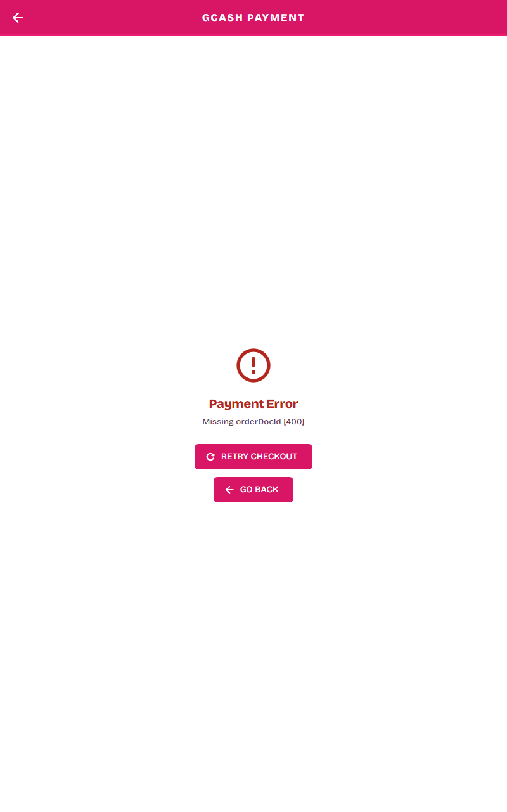
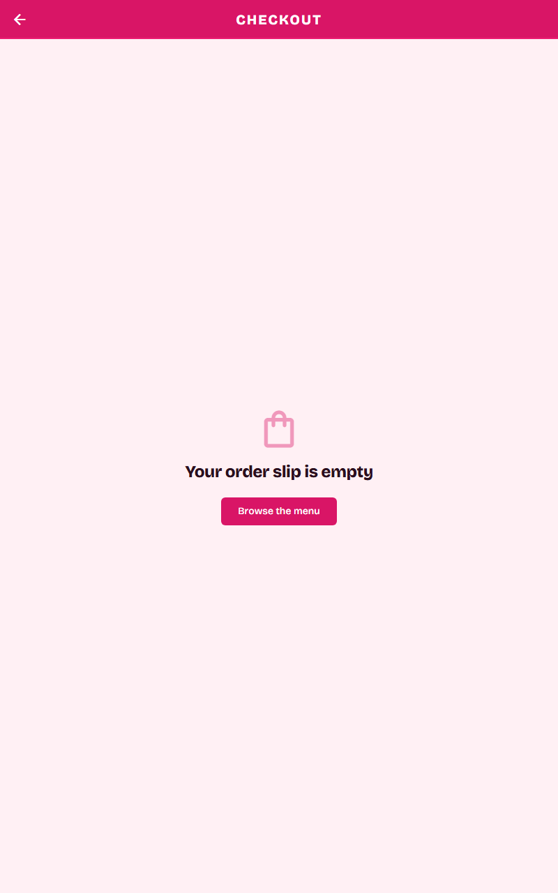

# Hardening pass — 2026-11-24

Audit of the storefront, kiosk and staff surfaces for performance, reliability,
security and correctness. Baseline `npm run ci` on this branch is green before
and after the change; the four fixes below are each covered by a test.

Source: `docs/evidence/ci-local.txt` (this branch).

## 1. The GCash handoff renders a dead page instead of bouncing (bug)

`/kiosk/gcash` read `luna.pending` from `sessionStorage` with an unchecked cast.
`validReceipt` already guarded the receipt handoff, but the payment handoff had
no validator, so a stale or hand-edited entry put the kiosk on a page whose
every action fails — the shopper had to back out by hand, and on an unattended
kiosk nobody does.

- `app/src/kiosk/handoff.ts`: new `validPending` (order-doc id shape, order
  number, positive amount, items, and a valid receipt).
- `app/src/pages/kiosk/gcash.astro`: `!validPending(pending)` clears `luna.pending`
  and replaces the URL with `/kiosk/checkout`.
- Test: `test/site/kiosk.test.mjs` — "the GCash handoff rejects a stale or
  hand-edited pending order" (10 rejected shapes, 1 accepted, plus the page guard).

## 2. Manual sales report spammed chats that already had it (reliability)

`triggerManualReport` sent to every chat and only recorded the outcome. When one
chat failed transiently the callable threw, the staff member tapped again, and
the retry re-delivered the report to the chats that had already received it.
`runDailySalesReport` was hardened against exactly this; the manual path was not.

- `functions/src/reporting/manual_report.ts`: extracted `runManualSalesReport`,
  which persists partial delivery to `daily_reports_sent/manual-<date>`
  (`status: 'failed'` + `deliveredChatIds`, TTL-bounded) and skips those chats on
  the next attempt. A *successful* send clears the list, so a deliberate second
  report of the day still reaches every chat.
- Test: `functions/test/hardening_baseline.test.js` — "runManualSalesReport skips
  chats that already received a failed attempt, then resets".

## 3. A paid PayMongo session could be dropped without a trace (security / observability)

The webhook only applied a verified `checkout_session.payment.paid` when both an
order reference and an integer paid amount resolved, and logged nothing
otherwise. Money in, no order marked PAID, no log line: nothing to investigate.

- `functions/src/payments/webhook.ts`: the decision now lives in a pure
  `checkPaidSession(attrs, payments)` that returns the order document id and the
  paid centavos, or the reason it cannot be applied. The handler logs that reason
  at `error` with the session id and reference number and still answers 200 (a
  retry cannot fix a session that carries no order reference).
- Test: `functions/test/hardening_baseline.test.js` — "a paid session that cannot
  be attached to an order is reported instead of dropped". It calls
  `checkPaidSession` directly (no order reference, no integer amount, fractional
  amount, empty payment list, healthy case, legacy reference number) and keeps one
  source assertion for the handler wiring, per `CODING_STANDARDS.md`'s
  behavior-over-source-text rule.

## 4. Two small performance/reliability fixes on the tablet and kiosk

- `app/src/staff/kds.ts`: the 30-second elapsed-time tick rebuilt every visible
  column (`renderBoard()`) whenever any card crossed the delayed threshold. It now
  patches the age text, colour, icon and both `is-delayed` classes on the card in
  place. On a cheap counter tablet that rebuild ran for the whole shift.
- `app/src/kiosk/lookup-spacing.ts` (new) + `app/src/kiosk/geo.ts`: Nominatim asks
  for at most one request a second. The map fires a reverse lookup per pan stop
  and a search can overlap it, so the kiosk could burst past the limit and get its
  IP throttled — every delivery address then degrades to raw coordinates. Both
  lookups now claim a slot at send time, at least 1 s apart; a lookup the shopper
  abandoned is told not to send and holds nothing, so adjusting the pin cannot
  push later addresses further behind.
- Tests: `test/site/staff.test.mjs` (the tick slice has no `renderBoard()`, and
  patches both `is-delayed` classes and the glyph) and `test/site/kiosk.test.mjs`
  (the Nominatim helpers are exercised directly; one wiring assertion covers both
  call sites in `geo.ts`, which cannot be imported under `node --test` because it
  reads `import.meta.env`).

## Checked and left alone

- `firestore.rules` and `firestore.indexes.json` are production-gated
  (`docs/DEPLOYMENT_STATE.md`); the rules-drift workflow would fail the PR.
- App Check enforcement is intentionally off behind a prod flag.
- `getActiveOrders`' seven-day scan and the missing composite index (REL-01 /
  PERF-01) need a deployed index, so they stay documented, not fixed.
- `CheckoutDraft` (`app/src/kiosk/checkout.astro`, `app/src/kiosk/map.astro`) is
  still read with an unchecked cast, so a hand-edited `lat`/`lng`/`pendingDocId`
  survives the merge over `fresh()`. Same class as fix 1 but pre-existing and
  wider (three call sites plus the map's coordinate use); deferred rather than
  half-done here. A `validDraft` mirroring `validPending` is the follow-up.
- Two concurrent `triggerManualReport` calls from different staff devices can
  still both send, because fix 2 reads the guard before sending and has no
  `sending` lease. Deliberate duplicate sends are legitimate, so a lease needs
  its own decision; the 5-minute per-uid rate limit bounds it meanwhile.
- `map.astro` keeps the previous `address`/`addressShort` while a new reverse
  lookup is in flight and gates Confirm on `address.length === 0`, so for one
  round trip the pin can move without the address following. Pre-existing and
  unchanged by the spacing fix (which bounds the wait at 1 s rather than
  removing it); a `pinRequestId` check on the address before enabling Confirm is
  the follow-up.
