# Landing-page menu: tap to see, mark to order

## What changed

- `site/index.html`, Menu & prices: each row's name/price is now a button that opens the dish photo inline (a taped snapshot that drops in and unclips from the row). One photo is open at a time; Escape or a second tap closes it.
- Each row has a real checkbox. Marking a row ticks it with a pen stroke and highlights the dish name. A slip slides up from the bottom with the count, the food total, **Clear**, and **Order these now**.
- **Order these now** links to `/kiosk/?pick=<id>&pick=<id#variant>…#/menu`. The pick values use the same `id` / `id#Variant` keys as `test/site_price_parity_test.dart`.
- Kiosk (`lib/services/menu_preselect.dart`): on the first menu build it reads the picks once and strips them from the URL, so a reload won't add them twice. Fixed-price items go straight into the cart. Items that still need a flavour (fries, 3-for-₱100 coolers) open their own option sheet in turn. The menu opens on the first picked section, and a toast confirms. The visitor stays on the menu to keep adding: no checkout.
- Photos are the kiosk's own assets (`/kiosk/assets/images/*.webp`, 7–13 KB each), loaded only when a row is opened.

## Proof (headless Chromium against the assembled `build/web`, Firebase/Google calls blocked)

Flow: open Shawarma Wrap's photo → mark Shawarma Wrap, Burger with Egg, Large Fries → tally shows `3 marked ₱220`, link `/kiosk/?pick=s1%23Solo&pick=f3&pick=b4#/menu` → kiosk loads with 2 in the cart and the Large Fries flavour sheet open → pick Cheese → `View order (3) · ₱220`, toast "Added 3 from the menu board", still on the menu. URL after load: `/kiosk/#/menu` (picks removed).

| Viewport | Photo open | Marked + tally |
|---|---|---|
| 320 | 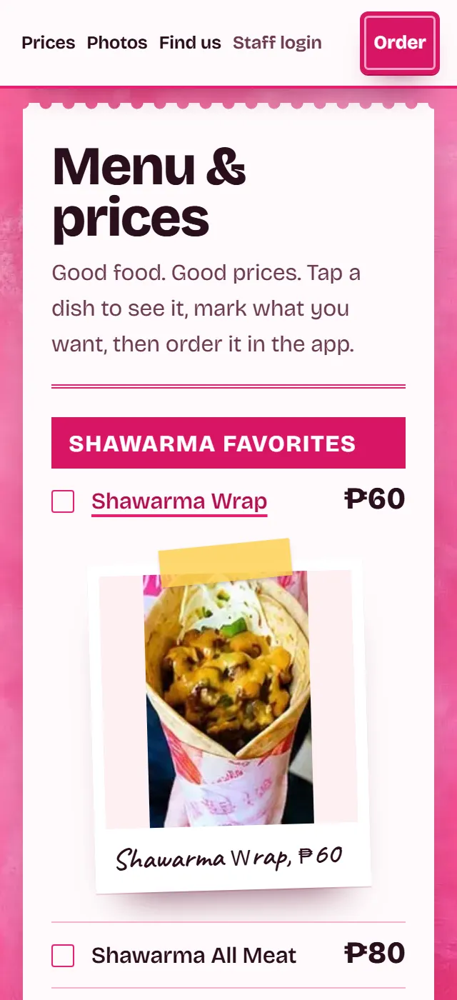 | 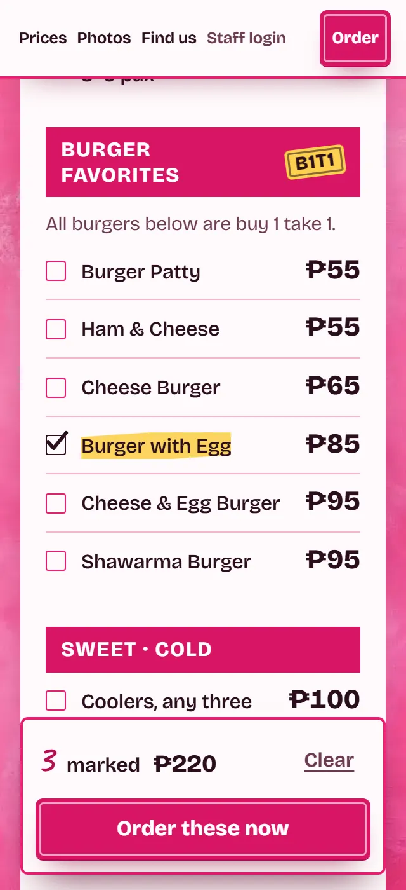 |
| 390 | 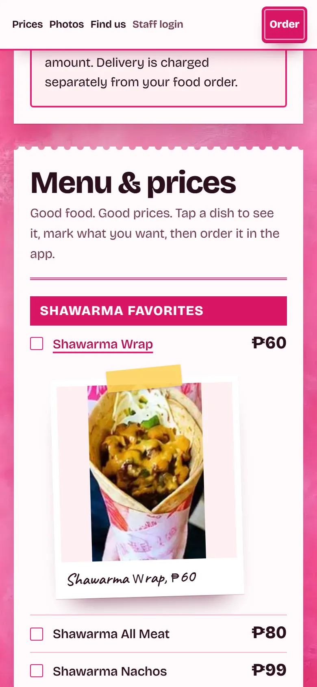 | 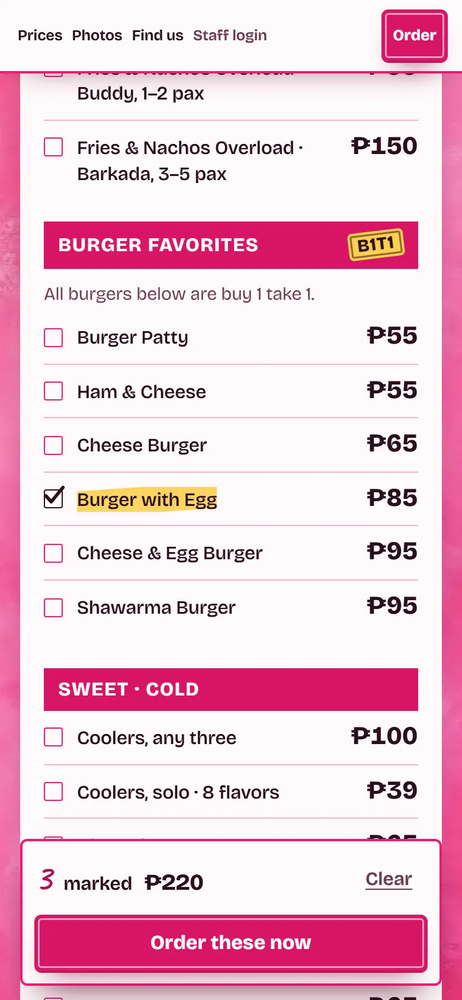 |
| 768 | 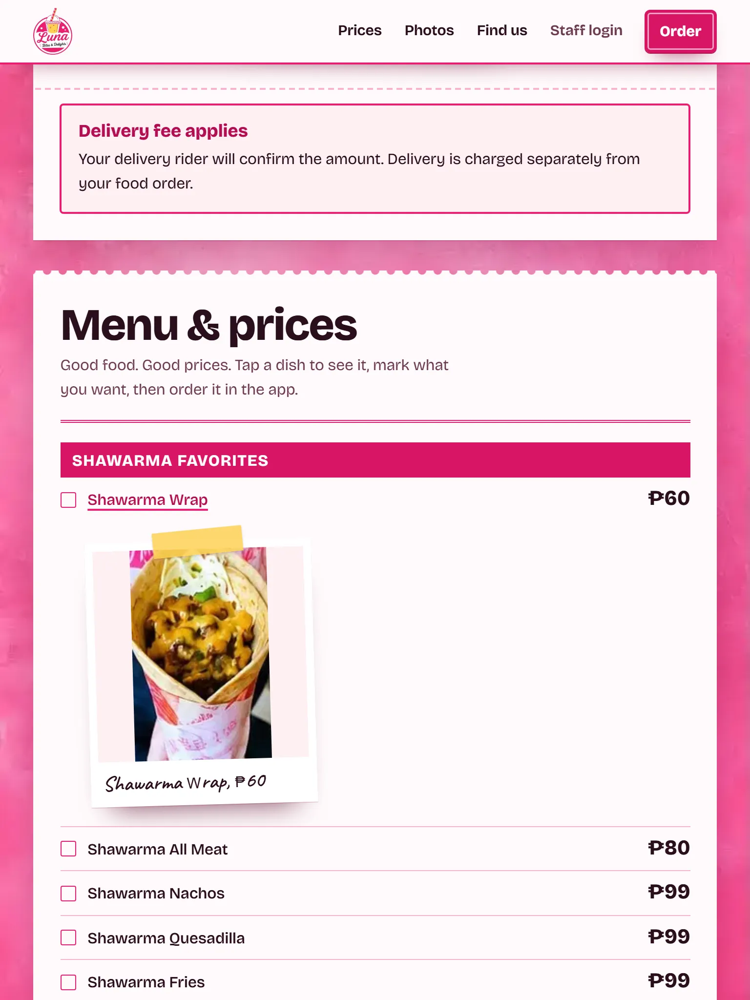 | 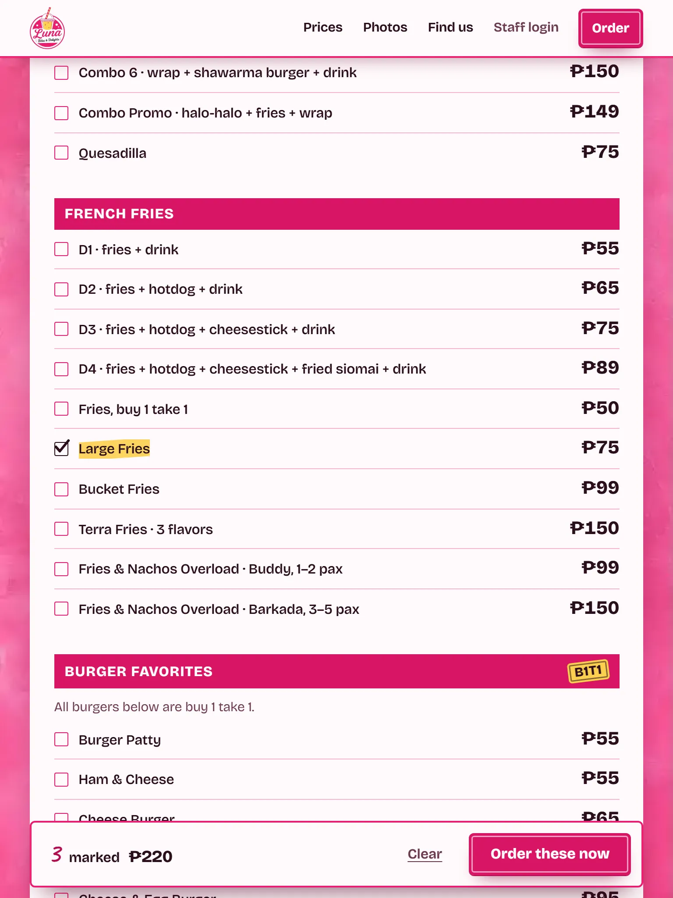 |
| 1440 | 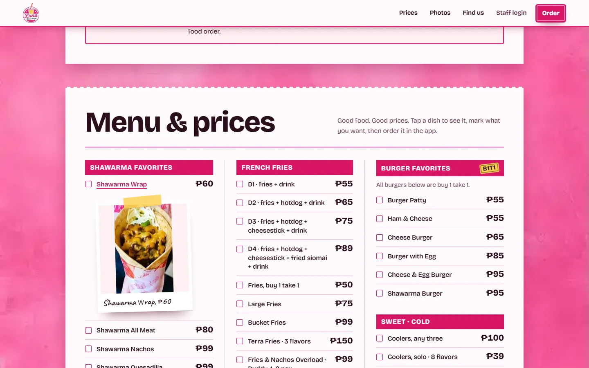 | 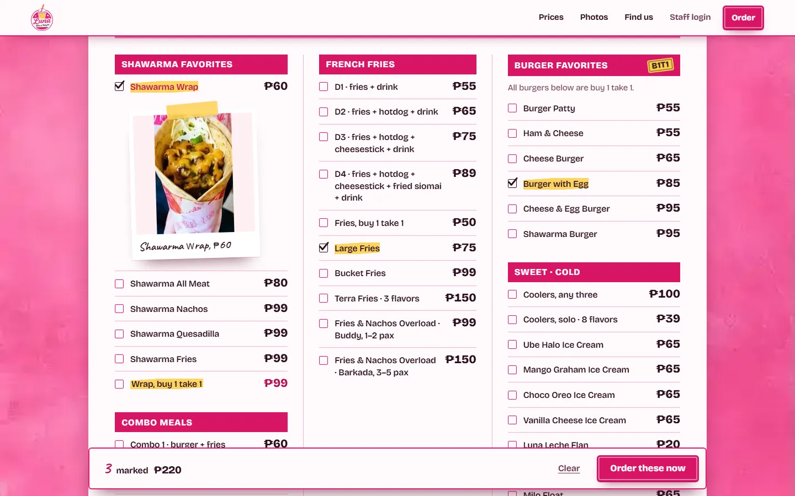 |

Motion, 80 ms into the reveal: 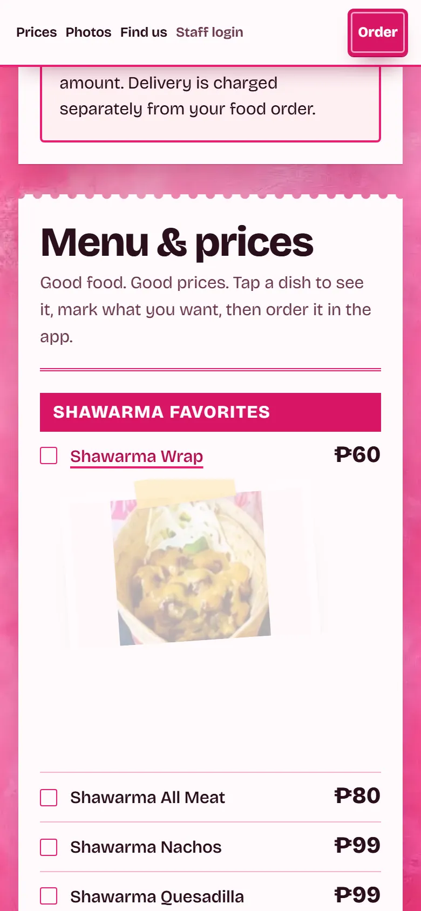

Kiosk: 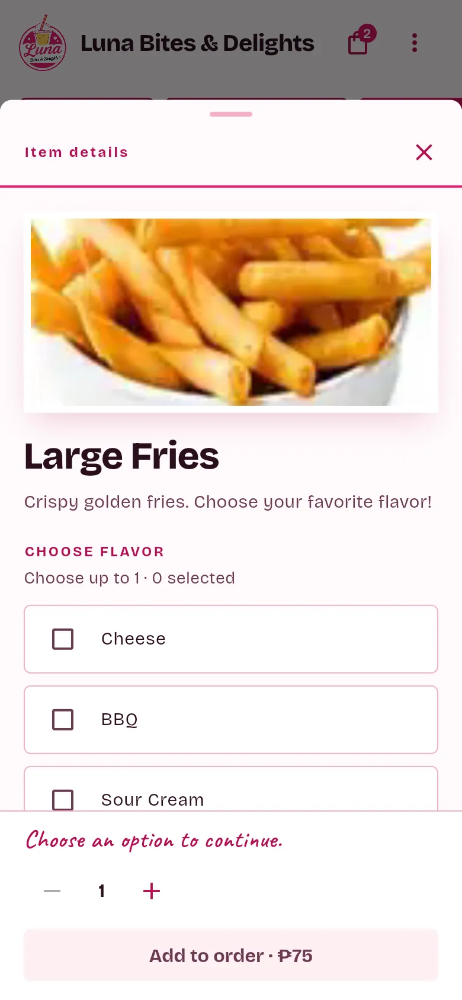 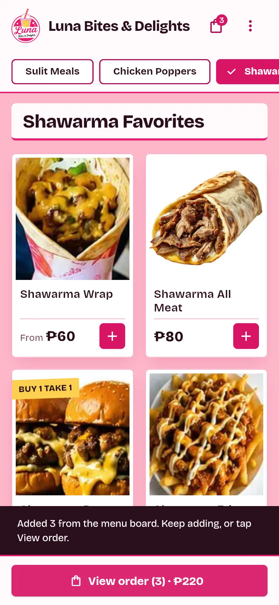

## Local CI (`.github/workflows/pr-checks.yml`)

- flutter analyze + baseline: 0 issues (`ci-analyze.txt`)
- dart format on changed files: clean (`ci-format.txt`)
- flutter test: 88 passed. One early local run reported two `menu_ordering_test.dart` tests as "did not complete" with no error text (the test process stopped; no assertion or timeout). It never came back: 30 full-suite runs after it all passed, 6 of them two suites in parallel at `--concurrency=16` (`flutter-test-stress.txt`), the CI `flutter` job passed twice on this head, and no failed PR Checks run in the repo's last 40 shows it. Neither affected test touches the pick code path., including `test/menu_preselect_test.dart`, which checks that every storefront row resolves to its printed price (`ci-flutter-test.txt`)
- flutter build web --release --wasm + assemble: built (`ci-web-build.txt`)
- site tests: 28 passed, including tally/link, one-photo-at-a-time, and pick/photo attributes (`ci-site-tests.txt`)
- functions build + npm audit: passed (`ci-functions.txt`)
- rules emulator (JDK 21): 23 passed (`ci-rules.txt`)

Reduced motion and `data-lite` devices get the same behaviour with no transitions.
