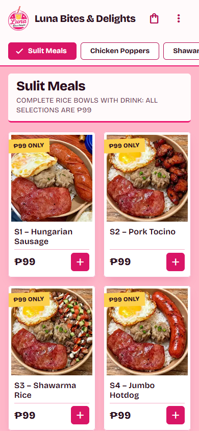
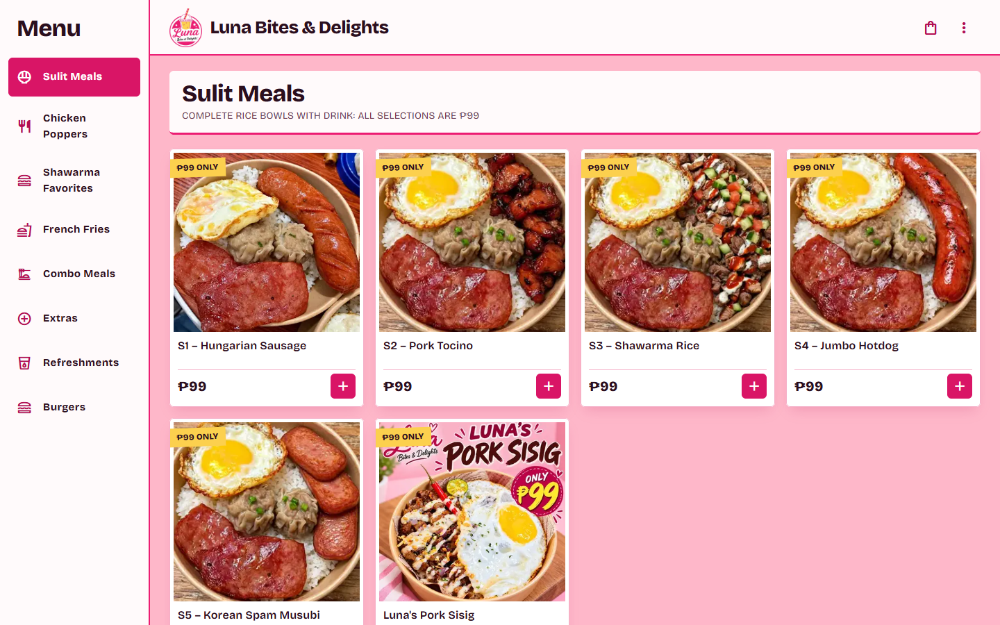
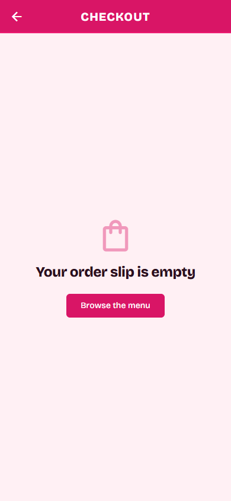

# Performance, reliability & security hardening — 2026-11-24

## Method

Three fresh audits ran against the current branch, covering `functions/src/`,
`app/src/` and the repo configuration (`firebase.json`, `firestore.rules`,
`.github/workflows/`, `tool/`). Prior hardening evidence and the last 15 commit
messages were read first so already-fixed issues were excluded. Every finding
below was re-read in source before a change was made.

## Fixed findings

| Finding | Severity | Fix | Proof |
| --- | --- | --- | --- |
| `dailySalesReport` had no retry policy. A transient aggregation/Telegram failure marked the guard `failed`, but nothing re-invoked the 22:00 job and the next run used a different `dateLabel`, so that day's report was permanently lost. | medium | Added `retryCount: 3` to the `onSchedule` options; `canClaimDailyReport` already reclaims a `failed` guard. | `functions/test/hardening_baseline.test.js` asserts the retry policy; full functions suite 93/93. |
| A successful map-photo send on the short-message path did not persist `photoSent`. If the following notification-state write failed all attempts, the reconciler re-fetched and re-sent the same photo to every chat. | medium | `sendDeliveryNotification` now calls `onPhotoSent()` on the non-split success path too, matching the split path. | Source guard asserts both paths persist `photoSent`; functions suite passes. |
| A failed middle Telegram chunk zeroed `deliveredChatIds`, so the caller re-sent earlier chunks to chats that had already received them. | low | `sendToAll` now carries the accumulated delivered set into the error for non-final chunk failures. | New functional test `multi-chunk Telegram failure keeps the chats that received earlier chunks` drives a 3-chunk send with a failing second chunk and asserts `deliveredChatIds: ['chatA']`. |
| Two module-level caches had no bounded TTL/invalidation, contrary to `CODING_STANDARDS.md`: the Telegram client never observed token rotation, and `staffSeeded` never re-checked an emptied/partially seeded collection. | low | `getBot()` rebuilds the client when `TELEGRAM_TOKEN` changes (custom test bots still short-circuit); `staffSeeded` became `staffSeededAt` with a 5-minute re-check TTL. | Source guards in `hardening_baseline.test.js`; functions suite passes. |
| Notification reconcilers fetched only the newest 50 orders in the 2-hour window before filtering out already-sent docs, so a busy window starved older unresolved orders. | low | Raised the bounded scan to 200 orders. | Source guard; functions suite passes. |
| Deploy workflows used the mutable `FirebaseExtended/action-hosting-deploy@v0` tag with production deploy credentials. | medium | Pinned both workflows to the v0 commit `500ac625…` and added least-privilege `permissions` to the merge workflow. | Workflow YAML parses in `npm run ci`; no action tag remains. |
| `npm run ci` dropped each workflow step's `env`, so the PR-proof step ran with empty variables and always passed locally — false assurance. | medium | `loadSteps()` keeps `env`; `runStep()` merges literal env; steps with GitHub expression env are skipped with an explicit `SKIP … needs PR context:` marker. | Local CI output above shows `SKIP site › Verify PR proof and attribution (needs PR context: PR_BODY, BASE_SHA, HEAD_SHA)`; `ci-local.test.mjs` asserts env survival and expression detection. |
| `checkPrProof` classified only UI and backend source paths, so changes to `firebase.json` (security headers/CSP), `firestore.indexes.json` (TTL), build config, `tool/` or workflows required no evidence. | medium | Those paths now require the same `docs/evidence/` reference as backend changes. | New `checkPrProof` cases in `ci-local.test.mjs`; 72/72 site tests pass. |
| GCash `cancel()` left the `PENDING` handoff in sessionStorage, so a direct revisit to `/kiosk/gcash` could re-open the abandoned order; the draft's pending fields also survived. | low | `cancel()` clears `PENDING` and the draft's pending/idempotency fields. | Source guard in `kiosk.test.mjs`; site tests pass. |
| `combineSignal()` called `AbortSignal.timeout()` unconditionally (throwing on older browsers) and dropped the deadline when `AbortSignal.any` was unavailable, leaving Nominatim requests hanging. | low | Feature-detected both APIs with a manual `AbortController` fallback that honours the caller's abort and the timer. | Source guard in `kiosk.test.mjs`; Astro check, lint and build pass. |
| `receipt.astro` trusted the shape of a sessionStorage JSON value; a corrupt `items` value threw before the receipt was unhidden, leaving a blank page with no escape button. | low | Added exported `validReceipt()` handoff validation; invalid data clears the key and redirects to the menu. | Functional test in `kiosk.test.mjs` covers valid and 6 corrupt shapes; 72/72 site tests pass. |

## Findings not changed (with reasons)

- **`firestore.rules` `riders` create/update lack field allowlists and the pasugo/rider authorization paths are untested.** Real, but `docs/DEPLOYMENT_STATE.md` and the rules-drift workflow require a coordinated production rules deploy; a code-only PR would fail the drift check. Tracked follow-up, like SEC-01/SEC-02 in the prior audit.
- **Reconciler cursor pagination.** Raising the scan to 200 bounds the common case; a persistent watermark across sweeps would be needed for unbounded backlogs. Not reachable at this kiosk's order volume within the 2-hour lookback.

## Verification

Full local CI on the final tree (`.github/workflows/pr-checks.yml` steps):

```text
functions  TS build, lint, unit tests, runtime audit       PASS
rules      Firestore rules emulator 25/25                  PASS
rules      derived-views emulator 4/4                      PASS
site       astro check (0 errors), lint, build (17 pages)  PASS
site       72 storefront/kiosk/staff tests                 PASS
```

Summary: [docs/evidence/ci-local.txt](ci-local.txt).

## Visual proof

The built site was served locally and screenshotted headlessly at the supported
viewports. No visual design changed; these confirm the affected kiosk pages
still render correctly at mobile and desktop sizes.







No production deployment, rules deploy, or data change was performed.
