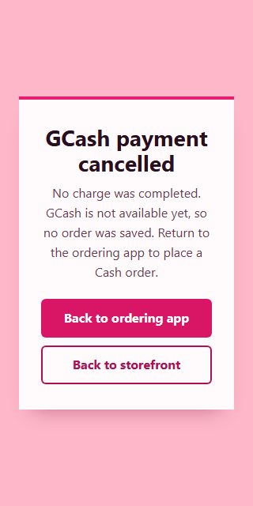
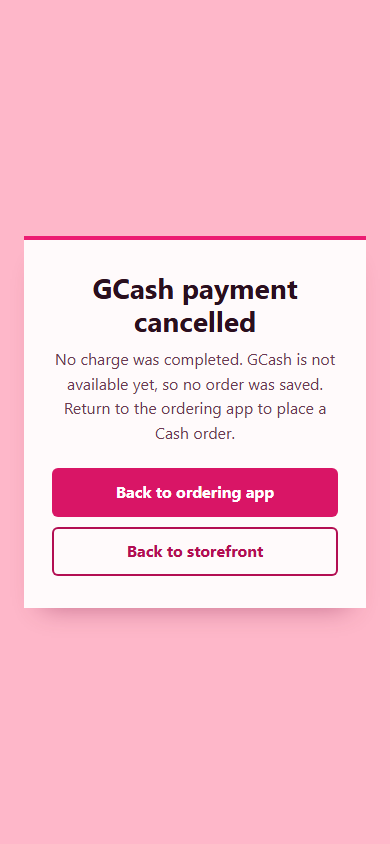
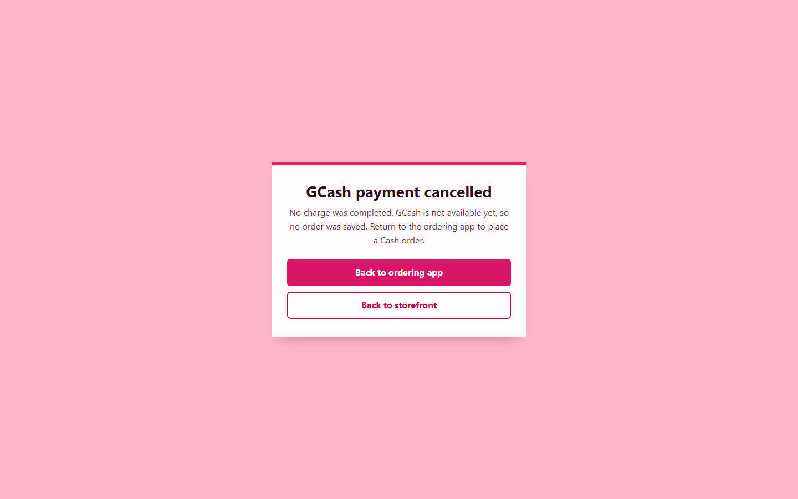

# Performance, reliability & security audit — 2026-11-23

## Method

Three fresh audits ran against the current `origin/main` (`e0c2c0a`), covering
`functions/src/`, `firestore.rules` / `firebase.json`, and `app/src/`. Prior
hardening evidence and the last 15 commit messages were read first so already
fixed issues were excluded. Every finding below was re-read in source before a
change was made.

## Fixed findings

| Finding | Severity | Fix | Proof |
| --- | --- | --- | --- |
| Payment-confirmation Telegram alerts were sent but could be permanently lost: after delivery, a failed sent-state write left no reclaimable lease, and the scheduled reconciler only retried new-order alerts. Stale events (>10m) were also skipped with no fallback. | medium | `reconcileMissedPaymentNotifications` in `functions/src/orders/send_notification.ts` reclaims GCash/PAID orders from the `paidAt` scan, with an isolated `paymentReconcileAttempts` counter. The scheduled job now runs both passes. | `functions/test/emulator/derived-views.test.js`: a paid order with an expired `sending` lease and `paymentNotifSent: false` is reclaimed, persisted as sent, and a second run is a no-op. 4/4 derived emulator tests pass. |
| The reconciler processed up to 50 sends strictly sequentially under a 60s default timeout — the worst case is exactly when Telegram is slow — so it could be killed after a few orders. | medium | `timeoutSeconds: 540`, `maxInstances: 1` (no overlapping sweeps), and `runBounded` chunks of 5 with per-order fault isolation in both passes. | `functions/test/hardening_baseline.test.js` asserts the schedule config and structured diagnostics; full derived emulator suite passes. |
| `aggregateDailySales` and `getSalesAnalytics` read every order for the day when `dailyStats` is not backfilled, on every call. | low–medium | Shared `scanOrdersForDate` in `functions/src/reporting/daily_stats.ts` caps the fallback at 20 pages × 1000 orders with cursor pagination; `failed-precondition` propagates to both callers. | Two focused tests in `functions/test/hardening_baseline.test.js` cover the cap and the short-page stop. |
| After enough checkout retries the 5-item `checkoutSessionIds` window evicted the customer's original session, so paying the original URL was rejected as a session mismatch while `PAYMONGO_WEBHOOK_SECRET` fallback verification was active. | low–medium | `initialCheckoutSessionId` is persisted on every session write (including a backfill for legacy orders) and accepted by `hasMatchingCheckoutSession`. | `functions/test/payment_reconciliation.test.js` verifies a rotated-out original session still matches; a source guard asserts both write paths backfill it. |
| Receipt line items came from the client cart while the grand total came from the server repricing, so the lines could disagree with the total and the staff ticket. | medium | `placeOrder` returns server-priced items; checkout uses them for the receipt and pending payment. | `test/site/app.test.mjs` guards the end-to-end wiring; 67/67 site tests pass. |
| A rejected staff password was re-inserted into the DOM on re-render, where the eye toggle could reveal it. | low | Clear the password on failed login, matching the PIN path. | Type-check, lint, build and site tests pass. |
| After GCash was disabled, the cancel snack and `/payment/cancel` still promised a saved order and a GCash retry that cannot happen. | low | Copy now states that no order was saved and asks for a Cash order; the GCash page no longer auto-opens a popup without user activation. | Screenshots below; site tests pass. |

## Findings not changed (with reasons)

- **`firestore.rules` legacy direct order `create` (`SEC-01`) and `pasugo_errands` `list: if true` (`SEC-02`).** Both are real, but `docs/DEPLOYMENT_STATE.md` marks them production-gated; the rules-drift workflow compares the file against live production and would fail a code-only PR. They need a coordinated rules deploy and are left as tracked follow-ups.
- **20,000-order page-cap boundary** in `scanOrdersForDate` throws even when the scan is exactly complete. This mirrors the existing `lifetime_report.ts` fallback and is not reachable at this kiosk's volume; a final probe query is not worth the extra read.
- **Staff GCash orders with no `paidAt`** would not be picked up by the payment reconciler. The GCash tile is disabled in checkout, so this path is unreachable in the current UI.

## Verification

Full local CI on the final tree (`.github/workflows/pr-checks.yml` steps):

```text
functions  TS build, lint, unit tests, runtime audit       PASS
rules      Firestore rules emulator 25/25                  PASS
rules      derived-views emulator 4/4                      PASS
site       astro check (0 errors), lint, build (17 pages)  PASS
site       67 storefront/kiosk/staff tests                 PASS
```

Summary: [docs/evidence/ci-local.txt](ci-local.txt).

## Visual proof

`/payment/cancel/` from the built site in headless Chrome with device-metrics
emulation at the supported viewports:







No production deployment, rules deploy, or data change was performed.
