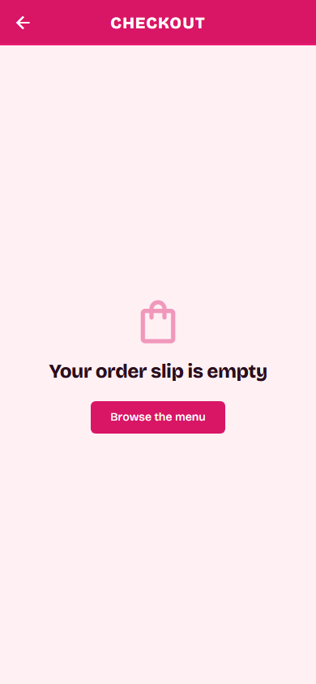
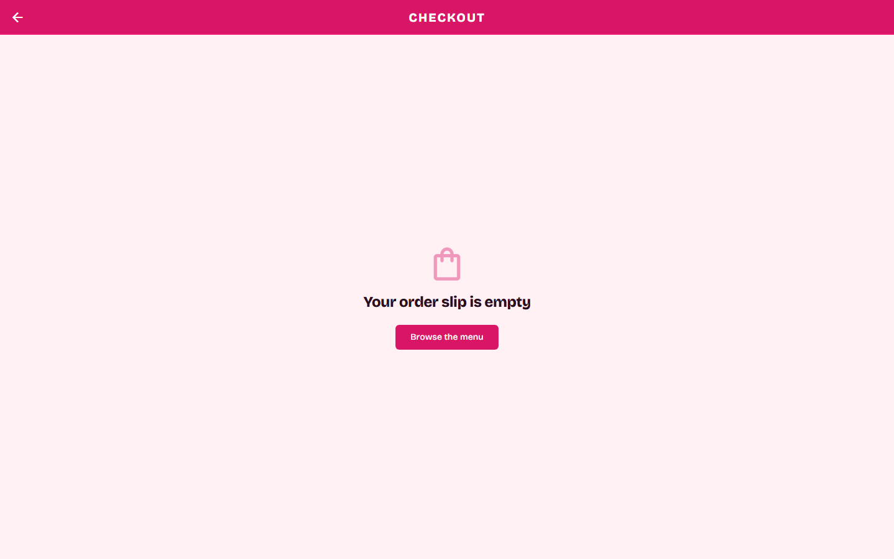

# Performance, Reliability, Security & Bug Fixes Proof

## Summary of Fixes

1. **Security — Redact secrets from transport/network errors (`functions/src/telegram_api.ts`, `functions/src/orders/send_notification.ts`):**
   - `telegramRequest` wraps `fetch()` errors and redacts `TELEGRAM_TOKEN` via `redactSecret()` before throwing, preventing bot credentials from leaking into Cloud Logging or Firestore `order_notifications.lastError` / `daily_reports_sent.lastError`.
   - `fetchMapImage` strips sensitive query parameters (`key`, `api_key`, `token`, `access_token`) via `redactUrlSecrets()` before logging transport warnings.
2. **Security — Bind `entryType` into order idempotency fingerprint (`functions/src/orders/place_order.ts`):**
   - `orderPayloadFingerprint` now includes `entryType` (`Kiosk` vs `Staff`), preventing cross-privilege idempotency collisions between kiosk and staff callers, while `matchesIdempotencyHash` retains backward-compatible matching against pre-deploy `legacyOrderPayloadFingerprint` hashes when `existing.entryType === entryType`.
3. **Performance & Reliability — KDS offline polling suppression and smart visibility reconnect (`app/src/staff/kds.ts`, `app/src/staff/kds-data.ts`):**
   - Added `shouldReconnectOnVisible()` so quick tab switches (`< 30s`) on a healthy live KDS listener do not tear down `onSnapshot` and re-download up to 200 `kds_orders` docs, while long sleep/wake transitions (`>= 30s`) and degraded/cached states still reconnect immediately.
   - Guarded `pollTimer`, `reconnectTimer`, and `onVisibilityChange` with `!isOffline`, and reset `connecting = false` alongside clearing `initialFallbackTimer` in `onOffline`, preventing doomed offline polls without orphaning stalled connects.
4. **Reliability — Automatic online recovery for deferred offline staff sessions (`app/src/staff/session.ts`):**
   - When `getIdTokenResult()` fails with `auth/network-request-failed` before a session is established (`defer`), registers a one-shot `online` listener (guarded by `authSeq` and cleared on `logout()`) to automatically re-verify and unlock the staff screen once connectivity returns.
5. **Bug — Align checkout phone `maxlength` with server cap (`app/src/pages/kiosk/checkout.astro`):**
   - Updated `input[name="phone"]` from `maxlength="40"` to `maxlength="32"` to match `placeOrder`'s server validation cap (`optStr(..., 32)`).

## Visual Proof

## Verification

- **Full local CI (`npm run ci`):** all 12 executed steps passed (see `docs/evidence/ci-local.txt`), including secret redaction tests (`telegramRequest`/`redactSecret`, `fetchMapImage`/`redactUrlSecrets`), `entryType` fingerprint isolation tests, `shouldReconnectOnVisible` and mounted KDS quick-switch/offline tests, `watchStaff` deferred-offline `online` recovery tests, and checkout `maxlength` parity tests.
