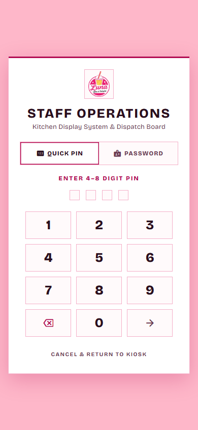
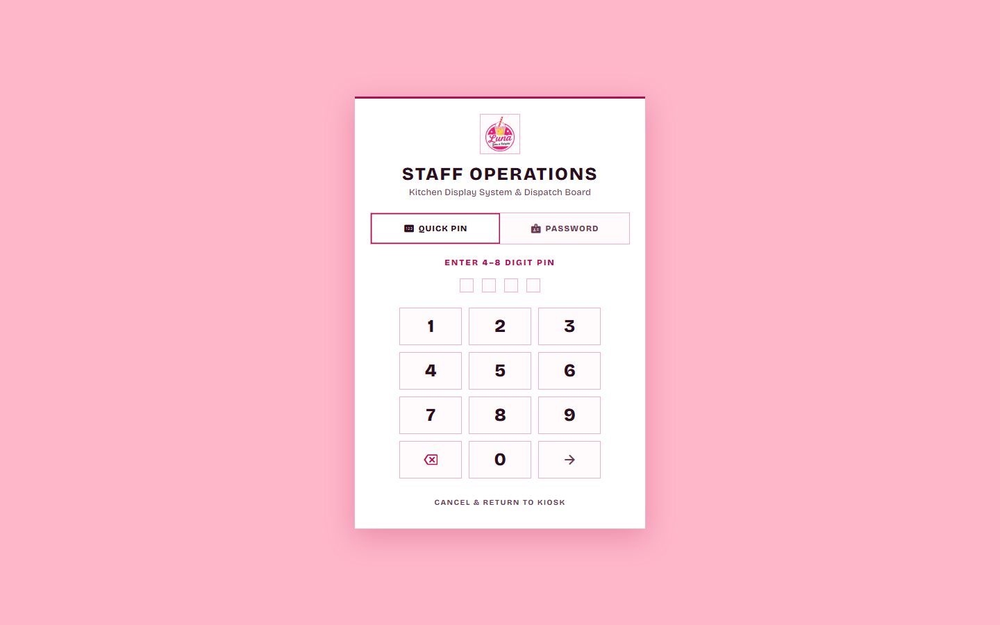

# Performance, Reliability & Security Improvements — Evidence

## Summary of Changes

The rebased diff keeps the fixes already landed in PR #79 and adds these remaining improvements:

1. **Retained from PR #79 — `notifyPaymentConfirmedOnce` (`functions/src/orders/send_notification.ts`)**
   - Persists `paymentDeliveredChatIds` on partial multi-chat failures and skips already-delivered chats on retry via `skipChatIds`.
   - Persists `paymentNotifStatus: 'failed_permanent'` on permanent Telegram errors and handles `'failed-permanent'` in `evaluatePaymentNotificationClaim`.
   - Retries persisting `paymentNotifSent: true` with bounded backoff after `sendToAll` succeeds, and never flips `paymentNotifStatus` back to `'failed'` or rethrows after delivery has already fired.

2. **Retained from PR #79 — `dailySalesReport` (`functions/src/reporting/daily_report.ts`)**
   - Separates Telegram delivery from post-send Firestore guard persistence (`runDailySalesReport`).
   - Only resets `daily_reports_sent/{dateLabel}` to `'failed'` if aggregation or Telegram send fails; retries `status: 'sent'` persistence with backoff and logs instead of resetting to `'failed'` if post-send persistence fails.

3. **Added here — `createCheckoutSession` (`functions/src/payments/create_checkout.ts`)**
   - Builds on PR #79's `parsePaymongoCheckoutResponse` safe parsing and URL allowlist.
   - Adds retryable upstream handling: PayMongo HTTP 429/5xx now returns `HttpsError('unavailable', ...)` instead of a generic internal error, so checkout can be retried.

4. **Added here — Staff Password Login Timing Side-Channel (`functions/src/auth/verify_staff.ts`)**
   - Runs a constant-cost dummy `scrypt` verification (`DUMMY_SCRYPT_HASH`) when a staff username does not exist, preventing username enumeration via response latency.

5. **Added here — `expireStaleUnpaidOrders` (`functions/src/orders/expire_unpaid.ts`)**
   - Processes stale `AWAITING_PAYMENT` order expiration transactions in bounded concurrent chunks (`EXPIRE_CONCURRENCY = 10` via `Promise.allSettled`) with per-document fault isolation so one transaction contention error does not abort the daily sweep.
   - Keeps `expireStaleUnpaidBatch(db, nowMs)` for PR #79 callers and adds `sweepStaleUnpaidOrders(db, opts)` for focused tests.

6. **Retained from PR #79 — `isDailyStatsBackfilled` Bounded Cache (`functions/src/reporting/daily_stats.ts`)**
   - Bounded 5-minute TTL on the warm-instance `true` cache while continuing never to cache `false`.

7. **Added here — Staff KDS & Login Lifecycle (`app/src/staff/kds.ts`, `app/src/staff/login.ts`, `app/src/staff/gate.ts`)**
   - `updateStatus` in `app/src/staff/kds.ts` calls `haltOnAuthError(...)` on `unauthenticated`/`permission-denied` responses to tear down listeners/timers, and calls targeted `renderBoard()` instead of `renderAll()` in `finally` so active search inputs are not clobbered.
   - `mountLogin` in `app/src/staff/login.ts` returns a cleanup function that clears the backspace hold timer and removes the document `keydown` listener, wired by `app/src/staff/gate.ts`.

## Screenshot Evidence

The staff gate after the lifecycle changes, rendered from the built site in headless Chrome at supported viewports and published to the `evidence` branch:

## Verification

- Added unit and regression tests in `functions/test/hardening_baseline.test.js` and `test/site/staff.test.mjs`.
- Executed full local CI (`npm run ci`), recorded in `docs/evidence/ci-local.txt`:
  - `functions`: TypeScript build, ESLint promise checks, 84/84 unit tests, runtime audit.
  - `rules`: 25/25 Firestore rules emulator tests, 3/3 derived-views emulator tests.
  - `site`: `astro check` (0 errors, 0 warnings), ESLint, `astro build` (17 pages), 66/66 storefront/kiosk/staff tests, runtime audit, PR proof & attribution check.
