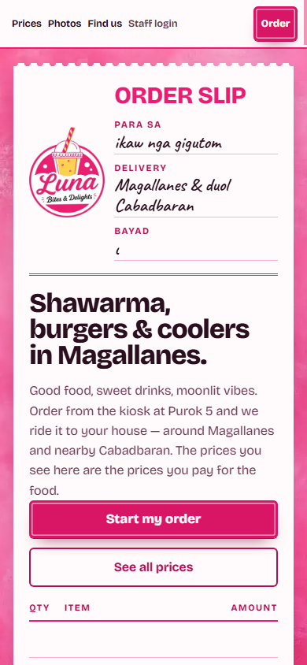
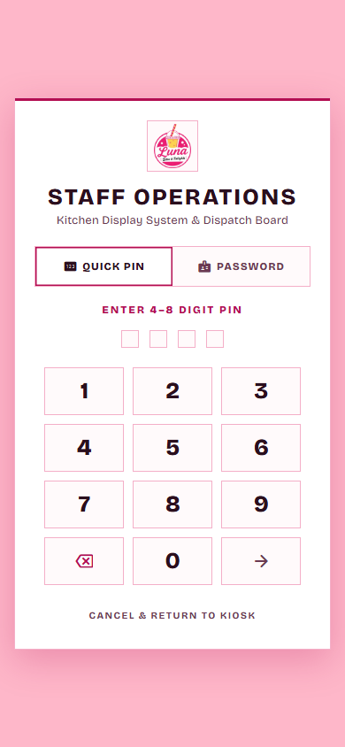
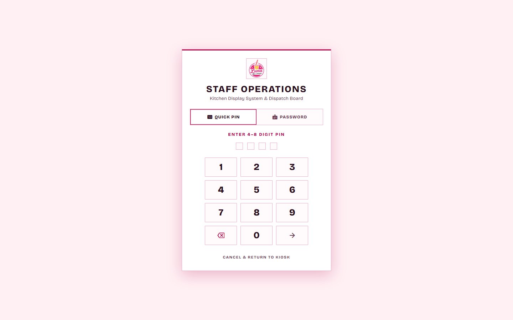

# Follow-up hardening evidence

Earlier merged hardening PRs already landed the shared Telegram idempotency, PayMongo response validation, backfill-cache TTL, daily-report delivery, expiry-sweep, KDS auth cleanup, and dummy-hash login timing work. This follow-up keeps only the issues that were not covered there.

## Changes proven by tests

- **Login hash validation:** both scrypt verifiers reject hashes that are not exactly 64 hex characters. Covered by `functions/test/staff_auth.test.js`.
- **PayMongo request path:** session IDs are URL-encoded before interpolation into the provider URL, so a malformed ID cannot alter the request path. Covered by `functions/test/payment_reconciliation.test.js`.
- **Order coordinates:** a delivery order only stores latitude and longitude when both values are valid; one valid and one invalid value stores neither. The surrounding order-creation path is covered by the functions unit suite.
- **Staff UI async lifecycle:** the dashboard order sheet is gated by staff presence, disposal, and request sequence. KDS reconnects the live listener after network recovery when polling is active. Covered by `test/site/staff.test.mjs`, type-check, lint, and build.

Commands run from the repository root:

```text
npm run ci -- --job=functions --no-evidence   PASS
npm run ci -- --job=site --no-evidence        PASS
npm run ci                                    PASS
```

The full run wrote `docs/evidence/ci-local.txt`. Every functions, rules, and site job passed on the final working tree.

## Visual proof

Captured from the built app with headless Chrome at the supported mobile and desktop viewports:







No production deployment or rules deploy was performed.
