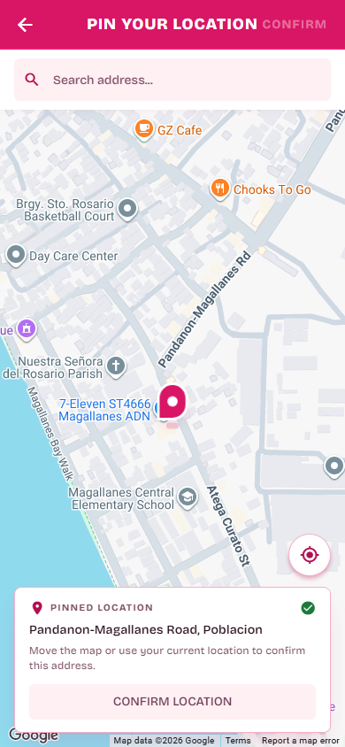
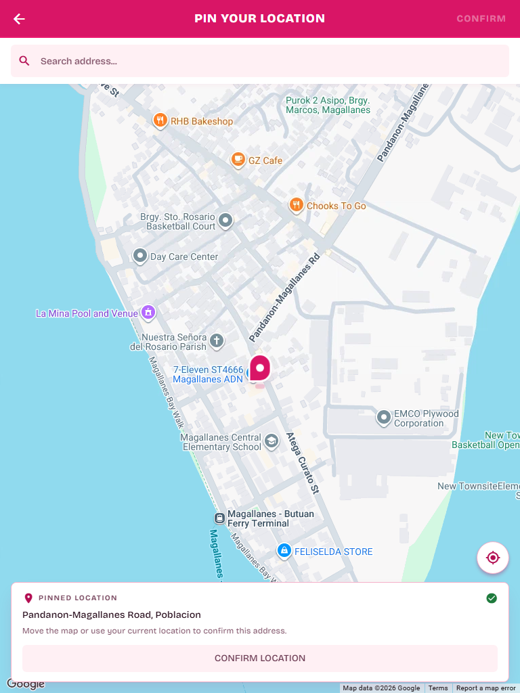
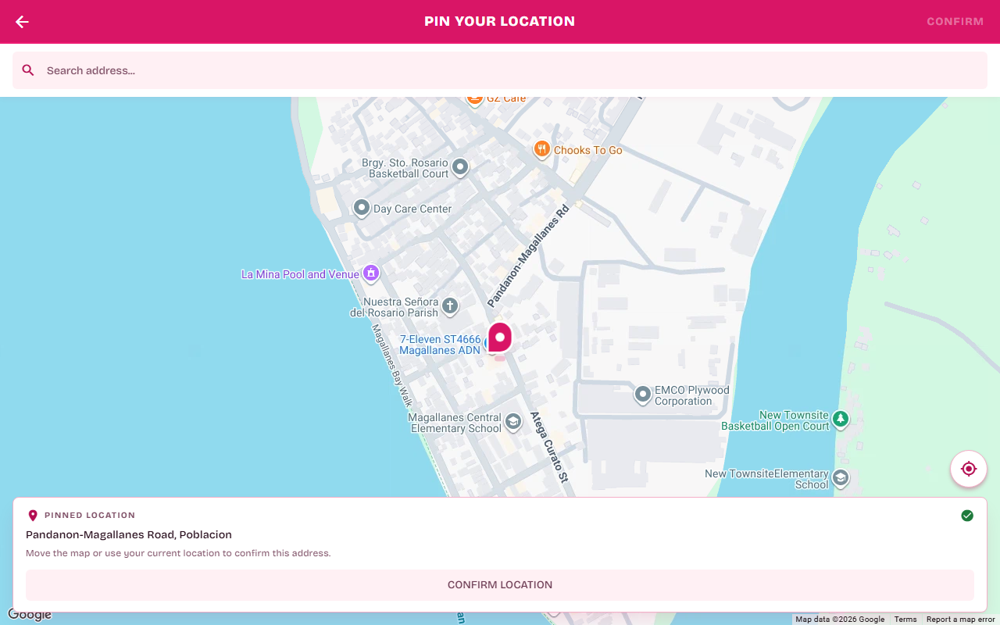
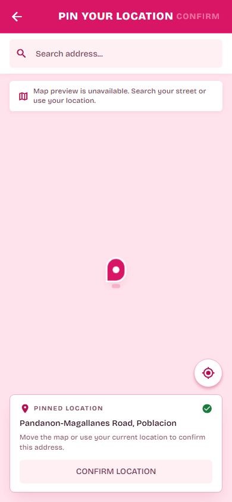
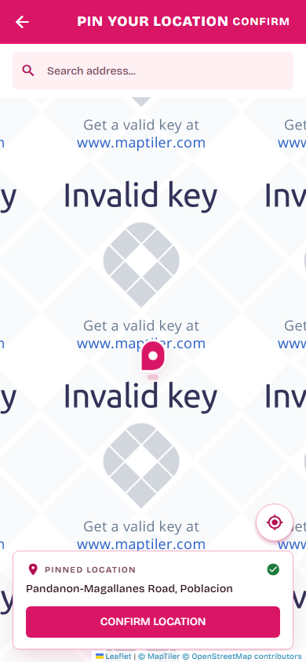

# Reliability & security audit follow-up — 2026-11-24

## Confirmed review findings fixed

| Finding | Change | Regression proof |
| --- | --- | --- |
| Summary-only dashboard reads returned zero for legacy orders without persisted `itemsCount`. | Preserve the legacy item-quantity fallback while keeping `items[]` out of the summary response. | `functions/test/hardening_baseline.test.js`: legacy and persisted-count paths. |
| The kiosk’s direct-write fallback included `itemsCount`, which the Firestore create allowlist rejects. | Keep the aggregate field off fallback client writes. | `test/site/kiosk.test.mjs` and functions order-write checks. |
| Payment-only notification documents could qualify as order-notification claims. | Require order-specific claim state before a kitchen notification can be claimed. | `functions/test/hardening_baseline.test.js`: payment-only records are rejected. |
| Concurrent PIN attempts could pass a read-only global budget check before failure counts were incremented. | Atomically reserve a global fixed-window attempt before PIN account verification; retain the failed-attempt budget. | `functions/test/hardening_baseline.test.js`: source/behavior guards for the pre-verification global attempt budget. |
| KDS listener startup could continue after an auth halt while Firebase imports were pending. | Re-check disposed/auth-halted state after asynchronous imports, before attaching a listener or scheduling follow-up work. | `test/site/staff.test.mjs`: auth-halt state is checked after startup awaits. |

## Additional guard improvements

- Firestore TTL parity is now derived from TypeScript `expireAt` writes and compared exactly with configured TTL field overrides. A synthetic writer test proves an unconfigured new collection is detected.
- Emulator scripts resolve the pinned root `firebase-tools` with `npm exec --prefix .. --no -- firebase-tools`; this uses the root lockfile and disables fallback downloads.
- The local CI summary distinguishes passed steps from skipped steps; the PR-context-only proof gate is explicitly skipped locally rather than reported as passed.
- The PR proof gate requires evidence references for package manifests, workflows, Firebase configuration, indexes, and tooling changes.

## Verification

`npm run ci` completed successfully on the final code tree: **12 executed steps passed; 6 steps were skipped** because dependencies were already current or PR-only context was unavailable. This includes Functions build/lint/unit tests/runtime audit, Firestore rules and derived-view emulator tests, Astro check/lint/build, runtime audit, and site tests. The full run is recorded in [`ci-local.txt`](ci-local.txt).

## Visual proof

The kiosk pin picker now draws Google Maps instead of MapTiler tiles. Builds without `PUBLIC_GOOGLE_MAPS_KEY`, or with a key the Maps JavaScript API rejects, drop to the site's own "Map preview is unavailable" notice instead of rendering a map-server watermark.

Rejected key: our notice replaces the map error overlay.

The existing GCash error-state screenshot includes the retry action: [hardening GCash mobile proof](https://github.com/khentmoba/LunaBitesAndDelights/blob/evidence/docs/evidence/hardening-gcash-390.png?raw=true).

## Map tile outage found during this work

The production `/kiosk/map/` screen was showing MapTiler's "Invalid key" watermark tiles, not a map. The key's HTTP-referrer allowlist only covered `lunaexpress.web.app`:

| Referer | Result |
| --- | --- |
| `https://lunaexpress.web.app/` | 200 |
| `https://lunabitesanddelights.web.app/` | 403 `Key usage restricted` |
| `https://lunabitesanddelights.firebaseapp.com/` | 403 `Key usage restricted` |

Production before the switch, at 390x844:

Google Maps replaces it. Verified end to end against a local build with a browser key: dragging the map re-resolves the address (`Pandanon-Magallanes Road, Poblacion` to `Pandanon-Magallanes Road, Magallanes`) and enables Confirm, and searching moves the map and fills the address. Address search and reverse geocoding still come from Nominatim, so they never depended on the map key.

## Independent review

- Round 1 confirmed five behavior issues (legacy summary counts, fallback-write allowlist mismatch, payment-only notification claims, PIN attempt concurrency, and KDS auth-halt startup race); all were fixed with regression coverage.
- Round 2 found a Functions-manifest proof-gate bypass, which was fixed and tested. Its other nit was ignored after verifying the cited older evidence file exists and is tracked.
- Round 3 re-reviewed the proof-gate fix and returned **SHIP**, with no new findings.
- The first PR rules run exposed that `npx` could not resolve the root-locked CLI from `functions/`; both emulator scripts now use the root npm prefix. The emulator suites and full local CI passed afterward.
- Round 4 re-reviewed the CI path fix and returned **SHIP**, with no new findings.

The audit also retains production-sensitive work: deny unauthenticated direct order creation and retire public legacy Pasugo/rider rules; enable callable App Check only after reviewing token metrics; replace the bounded KDS fallback scan only with a deployable index/query plan; and introduce a peppered PIN lookup only with Secret Manager provisioning and credential backfill. These require explicit production/deployment approval and operational confirmation. No Firestore rules, production App Check settings, production secrets, or deployed indexes were changed here.
