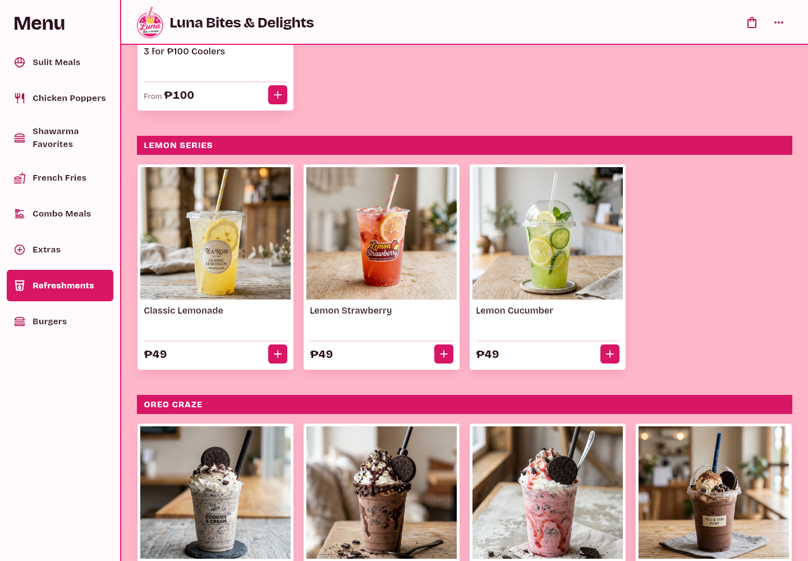
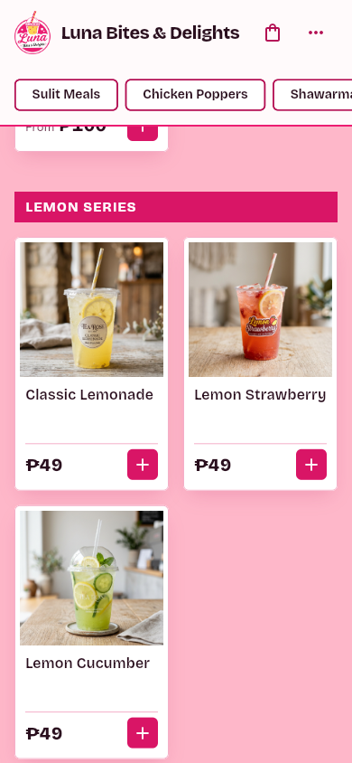

# Remove Soda Pop

Branch: `t3/remove-soda-pop`

## Summary

The owner retired the SODA POP subsection. The five fruit sodas — Green Apple, Strawberry, Sweet Orange, Mixed Berries, and Four Seasons — are gone from the kiosk menu.

The Strawberry **cooler** (₱39) stays. The menu had two Strawberry entries: the cooler `c_straw` and the ₱49 soda `d2`. Only the soda is retired.

## Changes by Surface

| Surface | Before | After |
|---|---|---|
| `lib/data/menu_data.dart` | `SODA POP` header plus five ₱49 Buy 1 Take 1 items (`d1`–`d5`) | Header and items removed |
| `functions/src/payments/create_checkout.ts` | Soda names in the active block | Moved to the cached-client block at their last prices |
| `functions/lib/payments/create_checkout.js` | Compiled price map | Rebuilt from the TypeScript source |
| `test/regression_test.dart` | No coverage | Asserts the four unique sodas and the header are gone, and the ₱39 Strawberry cooler remains |

The storefront (`site/index.html`, `site/menu/index.html`, `site/llms.txt`) never listed individual sodas — the board summarizes drinks under "Sweet · cold" — so it needs no change.

## Decisions

- **Strawberry stays as a cooler.** Only the ₱49 soda is retired; the ₱39 cooler keeps its card and its price.
- **Cached carts still resolve.** The server keeps all five names at ₱49 so an open tab can finish a checkout; the menu no longer offers them.

## Visual Proof

Captured headless at 1× device pixel ratio from the assembled `build/web` bundle (`flutter build web --release --base-href /kiosk/` plus `dart run tool/assemble_site.dart`).

*Desktop 1440px: the Lemon Series is followed directly by OREO CRAZE — no SODA POP section between them.*

*Mobile 390px: the Coolers flow straight into the Lemon Series with no soda cards.*

## Verification & CI Parity

Every job in `.github/workflows/pr-checks.yml` was executed locally:

| Job | Command | Result |
|---|---|---|
| flutter (analyze) | `flutter analyze --no-fatal-infos --no-fatal-warnings` + baseline check | 87 issues, baseline 87 — PASS |
| flutter (format) | `dart format --output=none --set-exit-if-changed` on changed files | 0 changed — PASS |
| flutter (tests) | `flutter test` | 41 passed, 0 failed — PASS |
| flutter (web build) | `flutter build web --release` | Built release web app — PASS |
| functions (build) | `cd functions && npm run build` | TypeScript compiled `src/` to `lib/` — PASS |
| functions (audit) | `cd functions && npm audit --audit-level=high` | 0 high or critical vulnerabilities — PASS |
| functions (tests) | `cd functions && npm test` | 16 passed, 0 failed — PASS |
| rules (emulator) | `cd functions && npm run test:rules` (JDK 21) | 8 passed, 0 failed — PASS |
| proof (verification) | `node tool/check_pr_proof.mjs` | Proof check passed — PASS |

The new regression test fails without the change: it asserts Green Apple, Sweet Orange, Mixed Berries, Four Seasons, and the SODA POP header are absent, and that a ₱39 Strawberry cooler is still present.
