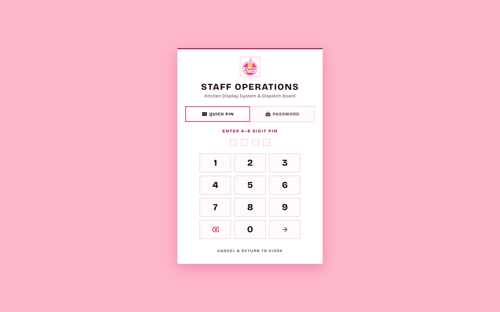

# Retrospective Environment & Guardrail Fixes (2026-11-23)

Evidence for the fixes from the 2026-11-23 project retrospective across all 42 post-TypeScript-migration threads since PR #70 (2026-11-18).

## 1. Zero-Dependency Worktree Bootstrap & Fast Local CI (`tool/ci-local.mjs`, `package.json`)

- **Problem:** Fresh T3 worktrees lack `node_modules/` across root, `app/`, and `functions/`. Because `tool/ci-local.mjs` had a top-level static `import { parse } from 'yaml'`, the first `npm run ci` in a fresh worktree crashed with `ERR_MODULE_NOT_FOUND: Cannot find package 'yaml'`. Furthermore, `npm run ci` ran `npm ci` 4 times per run (~106s) even when `node_modules/.package-lock.json` already matched `package-lock.json`, and unconditionally overwrote the tracked `docs/evidence/ci-local.txt` file on partial `--job=` runs.
- **Fix:**
  - `tool/ci-local.mjs` now checks for `node_modules/yaml` and auto-bootstraps root `npm ci` before dynamically importing `yaml`.
  - Added `isDepsCurrent(dir)` to skip `npm ci` steps automatically when `<dir>/node_modules/.package-lock.json` is up to date with `<dir>/package-lock.json` (override with `--install`), and added `npm run setup` (`node tool/ci-local.mjs --setup-only`).
  - Partial `--job=` runs and `--no-evidence` runs no longer overwrite `docs/evidence/ci-local.txt`.

## 2. Expanded ESLint Coverage (`app/eslint.config.mjs`, `functions/eslint.config.mjs`)

- **Problem:** ESLint in `app/` and `functions/` only enabled 2 promise rules (`no-floating-promises`, `no-misused-promises`) on `src/**/*.ts` and excluded `app/public/**/sw.js`.
- **Fix:**
  - Enabled `@typescript-eslint/no-unused-vars` (`^_` ignore pattern), `no-prototype-builtins`, `no-eval`, `no-implied-eval`, and `no-new-func` in both `app/eslint.config.mjs` and `functions/eslint.config.mjs`.
  - Added a dedicated service-worker lint block for `public/**/sw.js` in `app/eslint.config.mjs` with ServiceWorker globals (`self`, `caches`, `fetch`, `URL`, `location`, `Promise`, `Response`) and `no-undef` / `no-unused-vars` / `no-eval`.

## 3. Built-HTML CSP, Service Worker & Kiosk Inactivity Guards (`test/site/hosting.test.mjs`, `app/src/layouts/Staff.astro`, `app/src/staff/gate.ts`)

- **Problem:** CSP edits in `firebase.json` could break external embeds (e.g. `https://maps.google.com` in `frame-src`) while passing CI, and reviewers had to manually grep `.astro` files for `is:inline`, `on*=`, `watchInactivity`, and `sw.js` asset paths.
- **Production Bug Caught by New Guard:** On its first run against `build/app/`, the new built-HTML CSP test failed on `build/app/staff/*/index.html`: Astro had automatically inlined the 148-byte `<script>` in `app/src/layouts/Staff.astro` (`navigator.serviceWorker.register('/staff/sw.js', ...)`), which violated `/staff/**`'s strict `script-src 'self'` CSP in production and blocked staff service-worker registration.
- **Fix:**
  - Moved the `/staff/sw.js` registration out of `app/src/layouts/Staff.astro` into `gate()` in `app/src/staff/gate.ts` so it ships inside the external `/_astro/*.js` bundle permitted by `script-src 'self'`.
  - Added two automated tests in `test/site/hosting.test.mjs`:
    - `built HTML external origins and inline scripts match firebase.json CSP headers`: parses `firebase.json` CSP directives and verifies every external `https://` origin across all built HTML files under `build/app/**/*.html`, and asserts zero executable inline `<script>` blocks or `on*=` attributes under `build/app/{kiosk,staff,payment}/**`.
    - `every interactive kiosk page wires watchInactivity and staff sw.js asset prefixes exist`: verifies `watchInactivity` across all 6 interactive kiosk pages (`menu`, `cart`, `map`, `checkout`, `gcash`, `receipt`) and verifies `/kiosk/fonts/` exists in `app/public/kiosk/fonts`.
- **Live Browser CSP & Service Worker Proof:** Rendered `/staff/` in headless Chrome with the production `/staff/**` `Content-Security-Policy` header (`script-src 'self'` without `'unsafe-inline'`) at `390x844` and `1440x900`:
  - `cspViolations: []`, `consoleErrors: []`, `navigator.serviceWorker.getRegistration('/staff/') -> /staff/sw.js`

## 4. Cloud Functions Secret Binding & Firestore Config Invariants (`functions/test/hardening_baseline.test.js`)

- **Problem:** Reading an unbound `process.env.*` secret (such as `process.env.PAYMONGO_WEBHOOK_SECRET` with a fail-closed 503 gate) passed `tsc`, ESLint, and unit tests while breaking production webhooks.
- **Fix:** Added two automated tests in `functions/test/hardening_baseline.test.js`:
  - Scans all `functions/src/**/*.ts` files for `process.env.<VAR>` reads and asserts each is either declared via `defineSecret` in `functions/src/secrets.ts` or explicitly allowlisted with a documented fallback (and asserts `webhook.ts` preserves `fetchCheckoutSessionDetailed` API-verification fallback).
  - Asserts `firebase.json` wires `firestore.rules` and `firestore.indexes.json` and that all 6 TTL collection groups (`stats_events`, `rate_limits`, `login_attempts`, `kds_orders`, `order_notifications`, `daily_reports_sent`) have `expireAt` `ttl: true` `fieldOverrides` in `firestore.indexes.json`.

## 5. PR Proof & Attribution Gate (`tool/check_pr_proof.mjs`, `tool/publish_evidence.mjs`, `.github/workflows/pr-checks.yml`)

- **Fix:**
  - Exported `checkPrProof` in `tool/check_pr_proof.mjs` with an attribution regex check rejecting `Co-authored-by:` and AI model/harness names in `PR_BODY`, covered by `test/site/ci-local.test.mjs`, and wired into `.github/workflows/pr-checks.yml`.
  - Updated `tool/publish_evidence.mjs` to persist published `` lines to `.evidence-urls.md` (gitignored) so URLs survive session handoffs.

## 6. Reviewer Standards, Architecture & Deployment State Docs, Read-Only Prod Config Inspector, and Spec Kit Cleanup

- Added [CODING_STANDARDS.md](../../CODING_STANDARDS.md), [docs/ARCHITECTURE.md](../ARCHITECTURE.md), and [docs/DEPLOYMENT_STATE.md](../DEPLOYMENT_STATE.md), linked from [AGENTS.md](../../AGENTS.md) and [README.md](../../README.md).
- Updated [functions/scripts/check-firestore-rules-drift.js](../../functions/scripts/check-firestore-rules-drift.js) and added [functions/scripts/check-prod-config.js](../../functions/scripts/check-prod-config.js) (`npm --prefix functions run check:prod-config`) to automatically fall back to the local Firebase CLI refresh token (`~/.config/configstore/firebase-tools.json`) or `gcloud auth print-access-token` when `GOOGLE_APPLICATION_CREDENTIALS` is unset, providing zero-setup read-only inspection of live Secret Manager secret names (metadata only), live Firestore ruleset release status, and composite indexes.
- Removed stale `.specify/` (which still described the deleted Flutter frontend) and the 14 unused `.agent/skills/speckit-*` skill directories, and updated `.gitleaks.toml` to reference `app/src/kiosk/firebase.ts` instead of deleted `lib/firebase_options.dart`.
