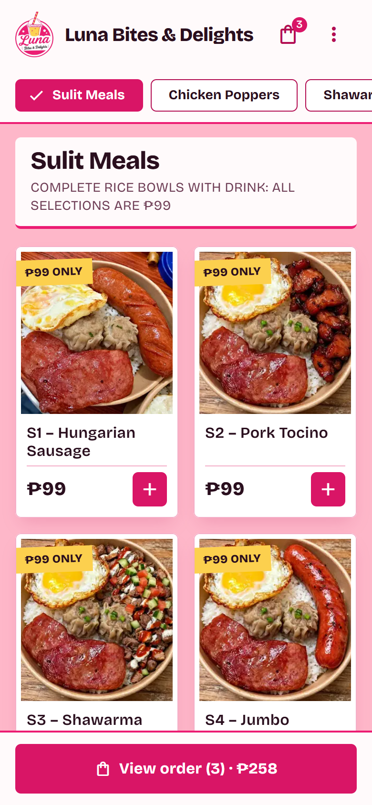
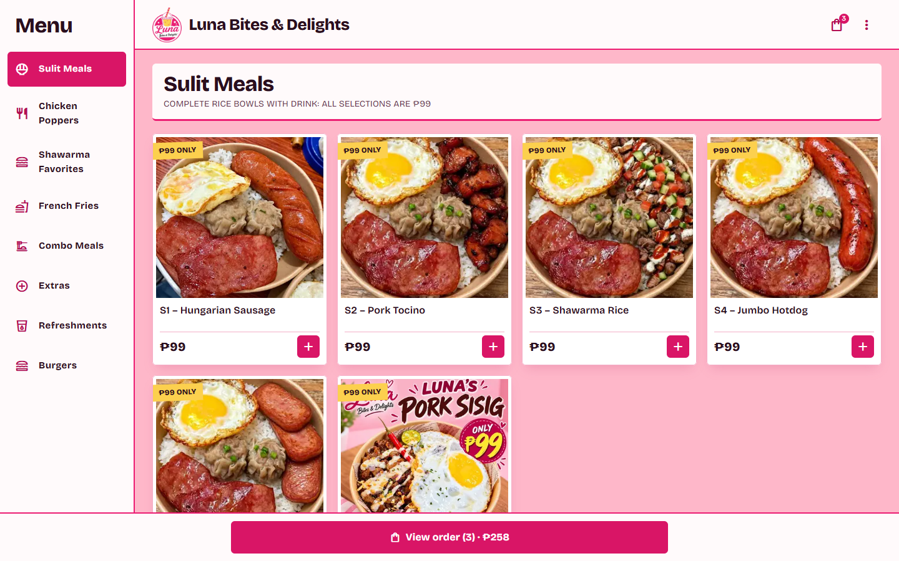
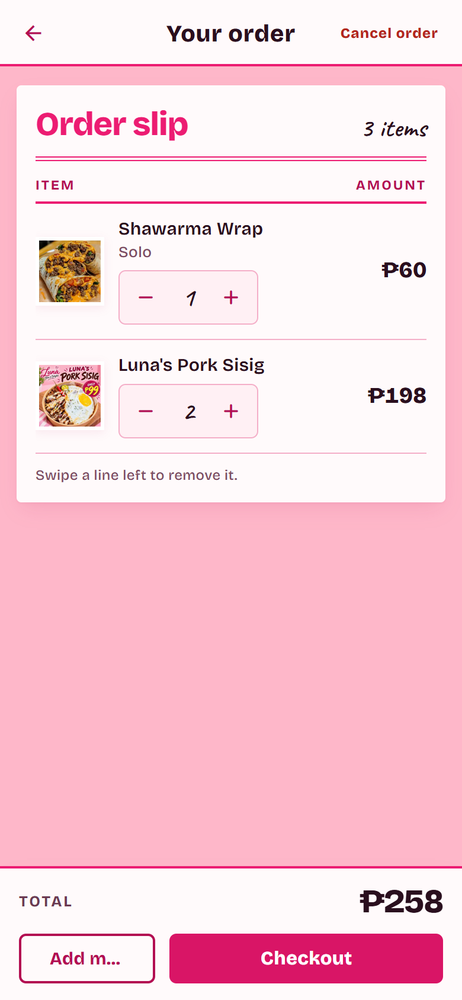

# Codebase simplification equivalence proof

No behavior change. Every existing check and the new characterization tests pass on both the untouched `origin/main` baseline and the final commits on `t3/simplify-codebase`.

## Scope of this PR

1. **Shared kiosk DOM helpers (`app/src/kiosk/dom.ts`)**: Extracted `$`, `$$`, and `esc` into `app/src/kiosk/dom.ts`, re-exported `esc` from `app/src/staff/ui.ts` to keep its public API identical, and removed the duplicated definitions across `cart.astro`, `checkout.astro`, `gcash.astro`, `map.astro`, `menu.astro`, and `receipt.astro`.
2. **Telegram broadcast consolidation (`functions/src/telegram_api.ts`, `functions/src/orders/send_notification.ts`)**: Consolidated the shared recipient parsing, `Promise.allSettled`, MarkdownV2 entity-parse fallback, error logging, and all-failed error throw in `sendToAll` and `sendPhotoToAll` into `deliverToAll`, preserving every log and error string. Simplified the redundant `googleMapsApiKey` fallback in `send_notification.ts`.

## Verification summary

- **Baseline (`origin/main` + characterization tests)**:
  - `functions`: `npm run build` (0 errors), `npm run lint` (0 errors), `npm test` (29/29 pass)
  - `app`: `npm run check` (50 files, 0 errors, 0 warnings, 0 hints), `npm run build` (17 pages built)
  - `root`: `npm run test:site` (49/49 pass)
  - `functions`: `npm run test:rules` blocked locally because this host has Java 8 (`1.8.0_461`) and `firebase-tools` requires Java 21+. `firestore.rules` is untouched; CI runs `rules` on Java 21.
- **Final commit (`t3/simplify-codebase`)**:
  - Full log saved in [simplify-codebase-pr-checks.txt](simplify-codebase-pr-checks.txt).
  - Runtime verification on `build/app/` in headless Chrome across `/kiosk/menu` (390px and 1440px), `/kiosk/cart` (390px), `/kiosk/checkout` (390px), and `/kiosk/receipt` (390px) with `Luna's Pork Sisig` and `Juan O'Neil` seeded to exercise apostrophe escaping in `esc`: 0 console errors, 0 uncaught exceptions, 0 horizontal overflow.

## Rendered kiosk checks

| Screen | Capture |
|---|---|
| Kiosk menu (390px) |  |
| Kiosk menu (1440px) |  |
| Kiosk cart (390px) |  |
| Kiosk checkout (390px) |  |
| Kiosk receipt (390px) |  |

## Remaining scope for later runs

- `functions/src/auth/verify_staff.ts`: `verifyStaff` combines seeding, PIN login, and password login in one 129-line handler.
- `functions/src/payments/webhook.ts`, `verify_payment.ts`, `create_checkout.ts`: repeated PayMongo Basic auth header construction (`Buffer.from(...)`) and order doc lookup.
