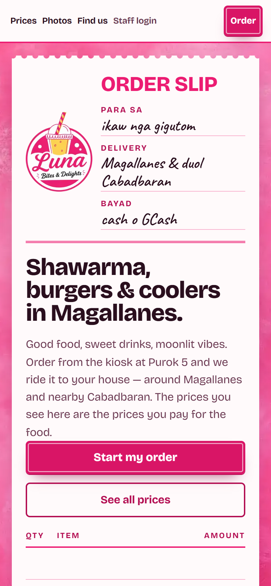
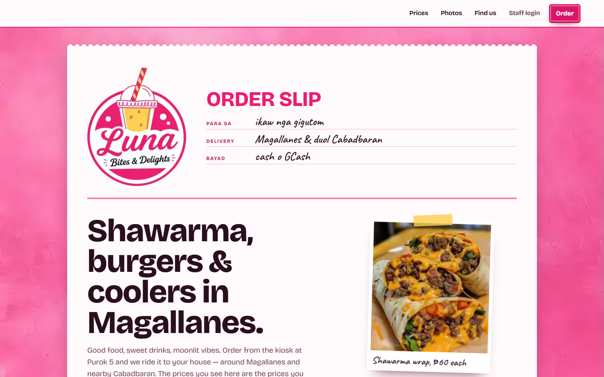
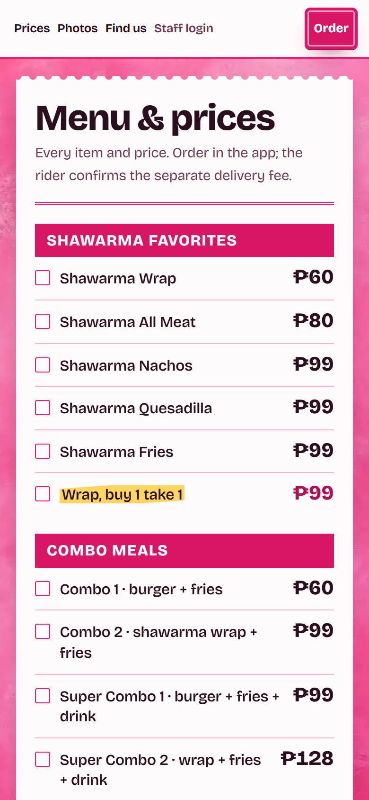
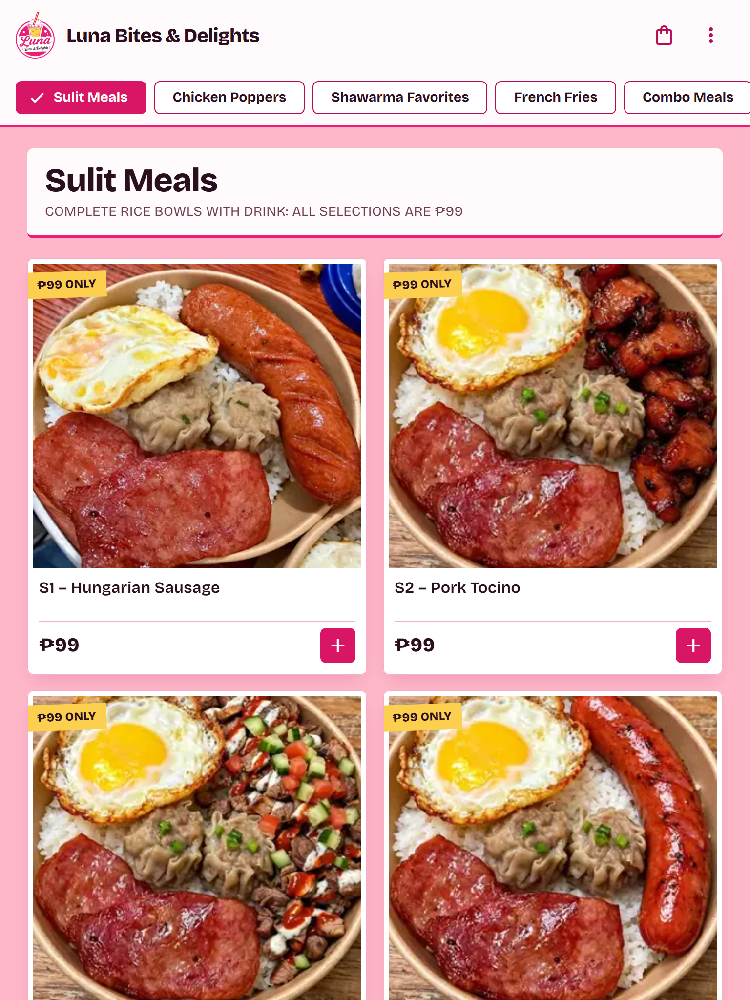
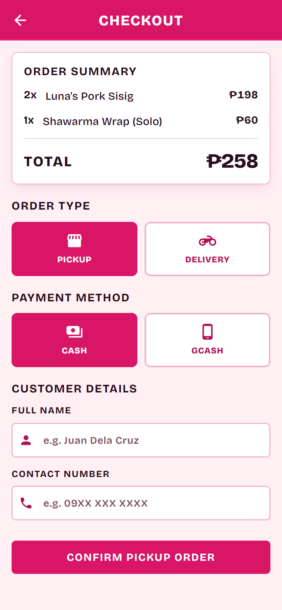
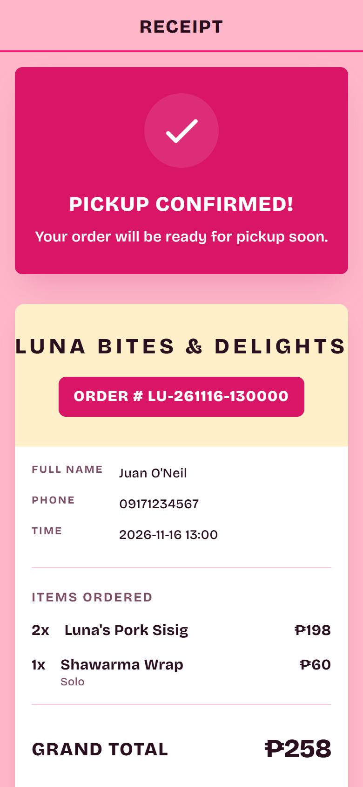
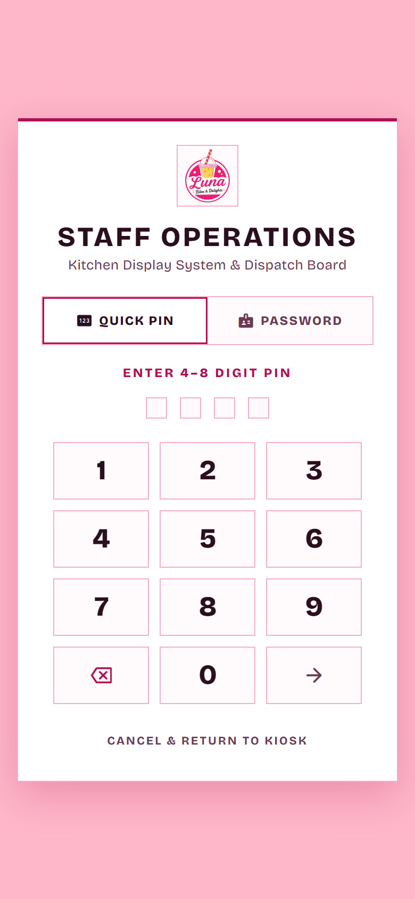
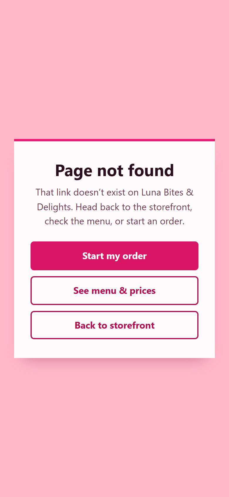

# Codebase simplification equivalence proof

No behavior change. Every baseline check and the added characterization tests pass on both `origin/main` (`3a8dd6e`) and the final commit on `t3/simplify-codebase`.

## Refactor plan & scope on PR #63

1. **Shared kiosk DOM helpers (`app/src/kiosk/dom.ts`)**: Extracted `$`, `$$`, `esc`, and `itemThumb` into `app/src/kiosk/dom.ts`, re-exported `esc` from `app/src/staff/ui.ts` to keep its public API identical, and removed the duplicated definitions across `cart.astro`, `checkout.astro`, `gcash.astro`, `map.astro`, `menu.astro`, and `receipt.astro`.
2. **Telegram broadcast consolidation (`functions/src/telegram_api.ts`, `functions/src/orders/send_notification.ts`)**: Consolidated `sendToAll` and `sendPhotoToAll` behind `deliverToAll`, keeping all log and error messages unchanged. Extracted `parseOrderNotificationInput`, `resolveStaticMapUrl`, and `sendDeliveryNotification` in `send_notification.ts`, and simplified `googleMapsApiKey` fallback.
3. **Break secret import cycles (`functions/src/secrets.ts`, `functions/src/index.ts`)**: Extracted `defineSecret` declarations into `functions/src/secrets.ts` and re-exported them from `functions/src/index.ts`, removing the circular `feature -> index -> feature` imports across 7 modules while keeping `index.ts` exports identical.
4. **Unify PayMongo & KDS helpers (`functions/src/payments/*.ts`, `functions/src/orders/kds.ts`, `functions/src/util/security.ts`)**: Added `paymongoAuthHeader`, `requireOrderDoc`, `markOrderPaymentFailed`, `ALNUM_DOC_ID`, and `itemQty`, removing duplicated Basic auth encoding, order validation/lookup, and payment-failed transactions.
5. **Decompose `verifyStaff` (`functions/src/auth/verify_staff.ts`)**: Split `verifyStaff` into `ensureStaffSeeded`, `createStaffToken`, `verifyPinLogin`, and `verifyPasswordLogin` while preserving exact rate-limit keys, legacy SHA-256 hash upgrades, error messages, and token payloads.
6. **Deduplicate staff & Astro storefront boilerplate (`app/src/staff/*.ts`, `app/src/layouts/NoticeCard.astro`, `app/src/data/storefront-menu.ts`)**: Reused `localStamp`, `phtDateLabel`, `showDialog`, `staffErrorMessage`, `isAuthErrorText`, and `mapsDirectionsUrl` across staff modules; extracted `NoticeCard.astro` for `/404.html`, `/payment/cancel/`, and `/payment/success/`, and `storefront-menu.ts` for `/` and `/menu/`.

## Verification summary

- **Baseline (`origin/main` `3a8dd6e`)**:
  - `functions`: `npm run build` (0 errors), `npm run lint` (0 errors), `npm test` (28/28 pass), `npm audit --audit-level=high` (0 high/critical)
  - `app`: `npm run check` (50 files, 0 errors/warnings/hints), `npm run build` (17 pages built), `npm audit --audit-level=high` (0 high/critical)
  - `root`: `npm run test:site` (48/48 pass)
  - `functions`: `npm run test:rules` blocked locally because this host has Java 8 (`1.8.0_461`) and `firebase-tools` requires Java 21+. `firestore.rules` is untouched; CI runs `rules` on Java 21.
- **Final commit (`t3/simplify-codebase`)**:
  - `functions`: `npm run build` (0 errors), `npm run lint` (0 errors), `npm test` (31/31 pass — includes 3 new characterization tests), `npm audit --audit-level=high` (0 high/critical)
  - `app`: `npm run check` (53 files, 0 errors/warnings/hints), `npm run build` (17 pages built), `npm audit --audit-level=high` (0 high/critical)
  - `root`: `npm run test:site` (51/51 pass — includes 3 new characterization tests)
  - Built HTML normalized diff against `origin/main` snapshots for `/`, `/menu/`, `/404.html`, `/payment/cancel/`, and `/payment/success/`: 0 structural/content differences.
  - Full check log saved in [simplify-codebase-pr-checks.txt](simplify-codebase-pr-checks.txt).
  - Runtime verification on `build/app/` in headless Chrome across `/`, `/menu/`, `/kiosk/menu`, `/kiosk/cart`, `/kiosk/checkout`, `/kiosk/receipt`, `/staff/`, and `/404.html` at 390px, 768px, and 1440px (with apostrophe test items `Luna's Pork Sisig` and `Juan O'Neil`): 0 console errors, 0 uncaught exceptions, 0 horizontal overflow.

## Rendered UI checks

| Screen | Capture |
|---|---|
| Storefront (390px) |  |
| Storefront (1440px) |  |
| Menu page (390px) |  |
| Kiosk menu (390px) |  |
| Kiosk menu (768px) |  |
| Kiosk menu (1440px) |  |
| Kiosk cart (390px) |  |
| Kiosk checkout (390px) |  |
| Kiosk receipt (390px) |  |
| Staff login (390px) |  |
| 404 page (390px) |  |
