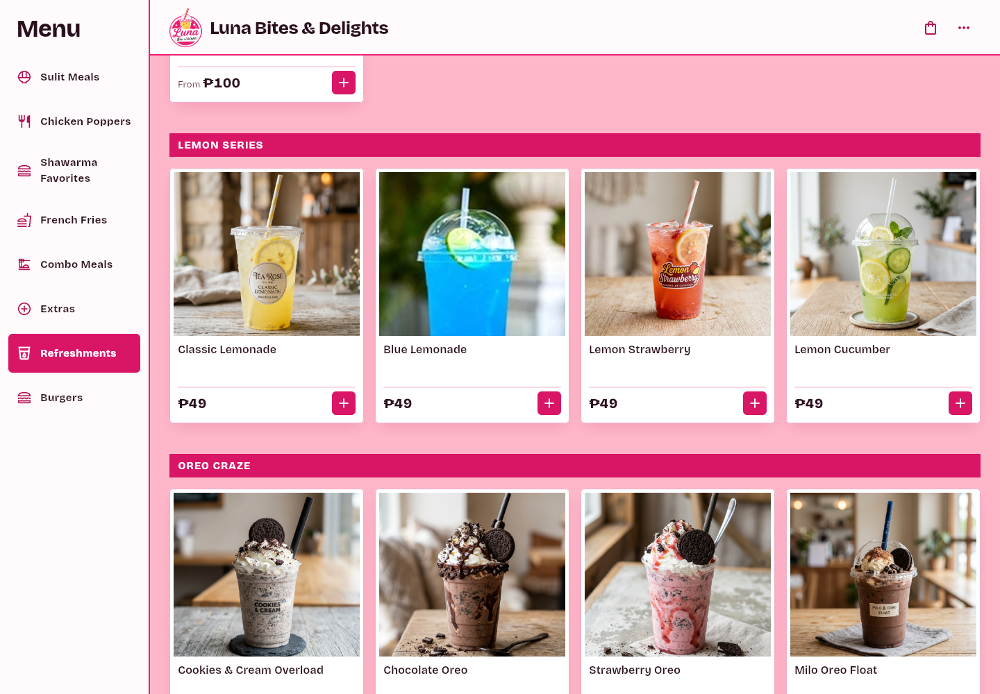
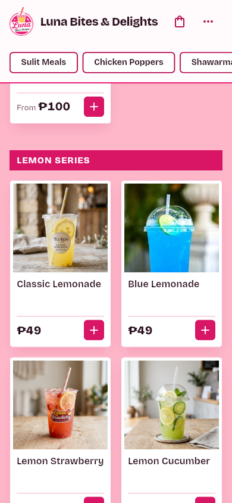
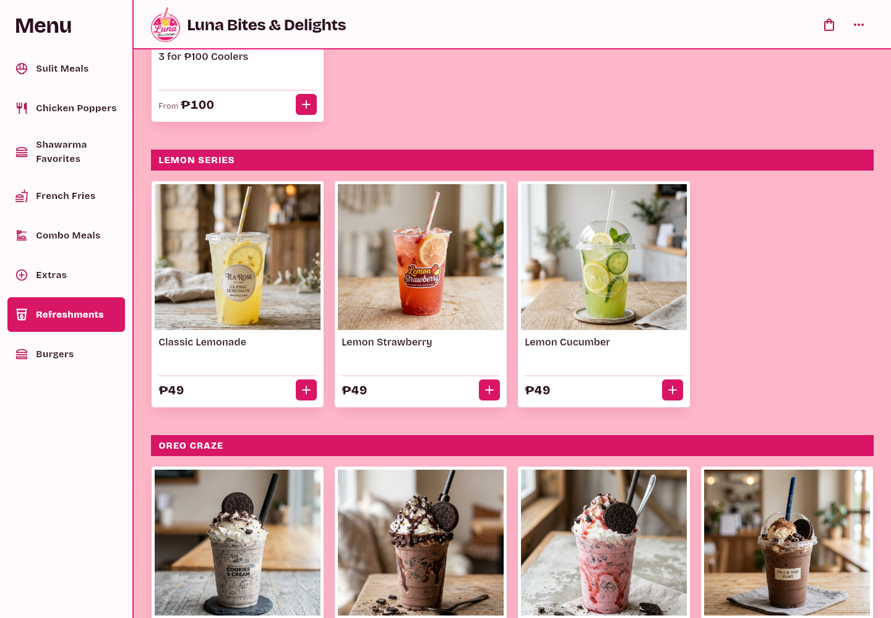
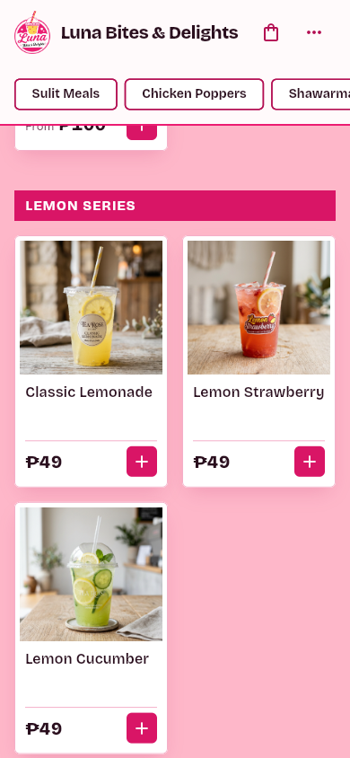

# Soda Pop Retired, Blue Lemonade Added

Branch: `t3/remove-soda-pop`

## Summary

Two owner changes on the Refreshments menu:

1. **SODA POP retired.** Green Apple, Strawberry (the ₱49 soda), Sweet Orange, Mixed Berries, and Four Seasons are gone from the kiosk menu.
2. **Blue Lemonade added.** It joins the Lemon Series at ₱49 with the owner's photo.

The Strawberry **cooler** (₱39) stays. The menu had two Strawberry entries: the cooler `c_straw` and the ₱49 soda `d2`. Only the soda is retired.

## Changes by Surface

| Surface | Before | After |
|---|---|---|
| `lib/data/menu_data.dart` | `SODA POP` header plus five ₱49 Buy 1 Take 1 items (`d1`–`d5`); Lemon Series had three drinks | Soda block removed; `Blue Lemonade` (`ls5`) added after Classic Lemonade at ₱49 |
| `images/blue_lemonade.png` | — | Owner photo, cropped square and resized to 800×800 |
| `functions/src/payments/create_checkout.ts` | Soda names in the active block; no Blue Lemonade | Sodas moved to the cached-client block at their last prices; `Blue Lemonade` added at ₱49 |
| `functions/lib/payments/create_checkout.js` | Compiled price map | Rebuilt from the TypeScript source |
| `test/regression_test.dart` | No coverage | Asserts the sodas and header are gone, the ₱39 Strawberry cooler remains, and Blue Lemonade is ₱49 with its asset on disk |

The storefront (`site/index.html`, `site/menu/index.html`, `site/llms.txt`) never listed individual sodas or the full Lemon Series — the board summarizes drinks under "Sweet · cold" — so it needs no change.

## Decisions

- **Strawberry stays as a cooler.** Only the ₱49 soda is retired; the ₱39 cooler keeps its card and its price.
- **Cached carts still resolve.** The server keeps all five soda names at ₱49 so an open tab can finish a checkout; the menu no longer offers them.
- **Blue Lemonade is ₱49**, matching the rest of the Lemon Series.
- **The photo is square-cropped.** The owner's file is 162×280; the crop keeps the dome lid, lime wheel, and blue drink, then upscales to 800×800 to match the other 800×800 assets. It is soft because the source is small.

## Visual Proof

Captured headless at 1× device pixel ratio from the assembled `build/web` bundle (`flutter build web --release --base-href /kiosk/` plus `dart run tool/assemble_site.dart`).

*Desktop 1440px: Classic Lemonade, Blue Lemonade, Lemon Strawberry, and Lemon Cucumber, all ₱49, with OREO CRAZE directly below — no SODA POP section.*

*Mobile 390px: the Lemon Series with Blue Lemonade at ₱49.*

*Desktop 1440px: the Lemon Series runs straight into OREO CRAZE — no SODA POP section between them.*

*Mobile 390px: the Coolers flow into the Lemon Series with no soda cards.*

## Verification & CI Parity

Every job in `.github/workflows/pr-checks.yml` was executed locally:

| Job | Command | Result |
|---|---|---|
| flutter (analyze) | `flutter analyze --no-fatal-infos --no-fatal-warnings` + baseline check | 87 issues, baseline 87 — PASS |
| flutter (format) | `dart format --output=none --set-exit-if-changed` on changed files | 0 changed — PASS |
| flutter (tests) | `flutter test` | 42 passed, 0 failed — PASS |
| flutter (web build) | `flutter build web --release` | Built release web app — PASS |
| functions (build) | `cd functions && npm run build` | TypeScript compiled `src/` to `lib/` — PASS |
| functions (audit) | `cd functions && npm audit --audit-level=high` | 0 high or critical vulnerabilities — PASS |
| functions (tests) | `cd functions && npm test` | 16 passed, 0 failed — PASS |
| rules (emulator) | `cd functions && npm run test:rules` (JDK 21) | 8 passed, 0 failed — PASS |
| proof (verification) | `node tool/check_pr_proof.mjs` | Proof check passed — PASS |

The new regression tests fail without the change: they assert Green Apple, Sweet Orange, Mixed Berries, Four Seasons, and the SODA POP header are absent, that a ₱39 Strawberry cooler is still present, and that Blue Lemonade is ₱49 with `images/blue_lemonade.png` on disk.
