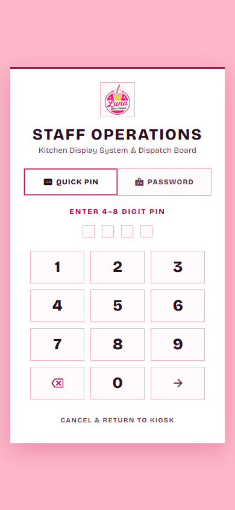
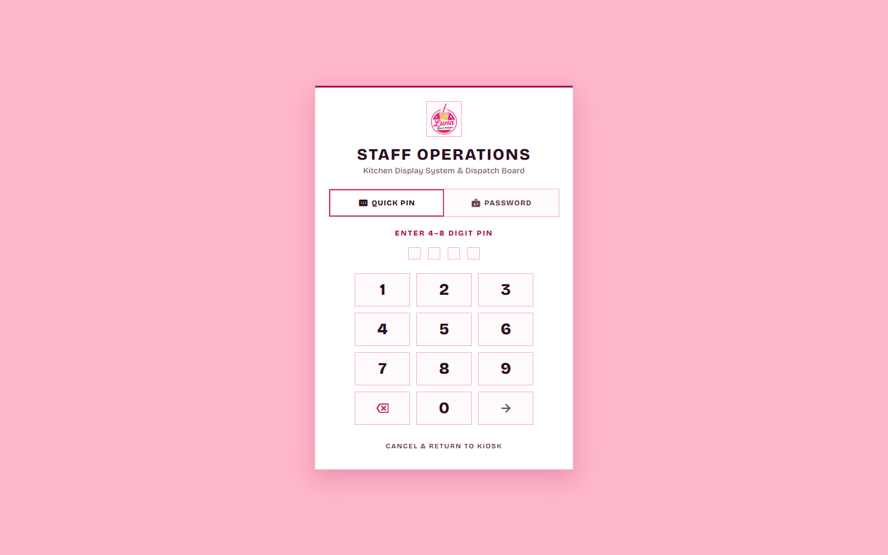
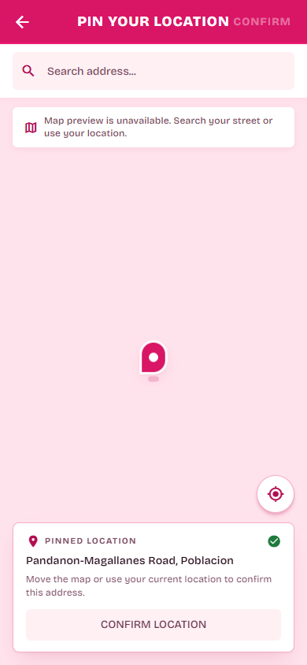

# Staff Auth, PayMongo Currency, Service Worker, and KDS/Map Hardening

## Changes Verified

1. **Per-username distributed password failure budget (`functions/src/auth/verify_staff.ts`)**
   - `verifyPasswordLogin` now checks `staff:pw_user:${username}` (20 failures per 15-minute window) via `checkWindowBudget` before reading `staff_accounts/{username}` and increments it atomically via `checkAndRecordWindowFailure` on failure.
   - Prevents distributed IP-rotating brute force against a staff account without introducing username enumeration.
   - Verified by `functions/test/staff_auth.test.js` (`verifyStaff enforces and clears per-username password failure budget across rotating IPs`).

2. **PayMongo PHP currency enforcement (`functions/src/payments/paymongo.ts`)**
   - `paidPaymentAmountCentavos` rejects paid payments whose explicit `attributes.currency` is not `PHP` (case-insensitive), while remaining compatible with omitted currency fields.
   - Verified by `functions/test/payment_reconciliation.test.js` (`paidPaymentAmountCentavos accepts PHP or omitted currency and rejects non-PHP currencies`).

3. **Immediate staff service worker registration when already loaded (`app/src/staff/gate.ts`)**
   - Extracted `registerStaffServiceWorker()` so `/staff/sw.js` registers immediately when `document.readyState === 'complete'` instead of missing an already-fired `load` event.
   - Verified by `test/site/staff.test.mjs` (`registerStaffServiceWorker registers immediately when document is already complete`).

4. **Clear submitted staff password from DOM on success (`app/src/staff/login.ts`)**
   - `verify()` now clears `pass = ''` unconditionally in `finally` so a submitted password is never re-rendered into `<input name="pass" value="...">` while `onAuthStateChanged` settles.
   - Verified by `test/site/staff.test.mjs` (`mountLogin clears submitted password from DOM even on successful verification`).

5. **KDS auth-halted dead buttons & map pagehide cleanup (`app/src/staff/kds.ts`, `app/src/pages/kiosk/map.astro`)**
   - KDS disables the header `sync` button and omits the dead `RETRY` button when `authHalted` is true, leaving `SIGN IN` as the actionable control.
   - `/kiosk/map/` clears pending search/reverse-geocode timers and aborts in-flight Nominatim requests on `pagehide`.
   - Verified by `test/site/staff.test.mjs` (`disposePendingLookups clears timers and aborts controllers, and kds locks actions on auth halt`).

## Local CI & Rendered Proof

- `npm run ci` passed all 12 executed steps (`docs/evidence/ci-local.txt`).
- Rendered screenshots captured from `build/app` at mobile (`390x844`) and desktop (`1440x900`) viewports and published to the `evidence` branch (`e138c60`):
  - 
  - 
  - 
