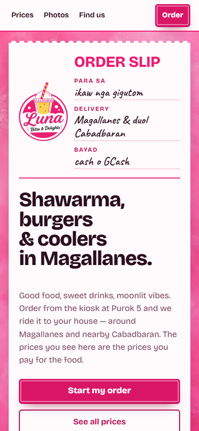
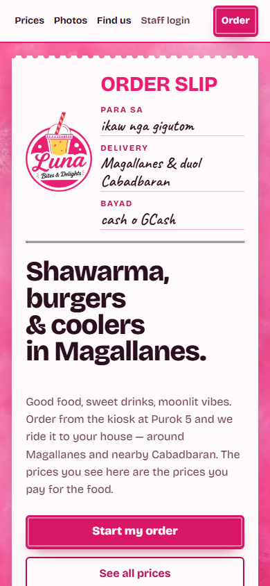
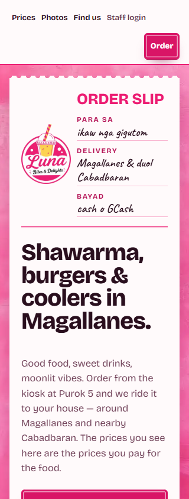

# Restore Staff login link on mobile header

## Root cause

Commit `753a24c` (`fix(mobile): keep sticky nav single-row...`) added `.bar__nav .bar__staff { display: none; }` inside `@media (max-width: 520px)` in `site/styles.css`, hiding the header "Staff login" link on all mobile viewports (`<= 520px`).

## Fix

- `site/styles.css`: Removed `.bar__nav .bar__staff { display: none; }`, switched `.bar` and `.bar__nav` to `flex-wrap: wrap` at `<= 520px`, and tightened `.bar` / `.bar__nav` / `.stamp--sm` spacing so all four nav links (`Prices`, `Photos`, `Find us`, `Staff login`) and the `Order` stamp fit on a single row at `360px`–`520px` (`barHeight: 62px`) and wrap cleanly at `320px` (`barHeight: 110px`) or enlarged text scales with zero horizontal overflow and `44px` tap targets.
- `test/site/app.test.mjs`: Added a regression test asserting `.bar__staff` is present in both `site/index.html` and `site/menu/index.html` and is not hidden via `display: none` in `site/styles.css`.

## Screenshots

Before (390 × 844 — `Staff login` hidden):

After (390 × 844 — single-row header with `Staff login` visible):

After (320 × 844 — wrapped header with `Staff login` visible, 0 overflow):

## Viewport measurements

| Viewport | `barHeight` | Horizontal overflow | `Staff login` visible |
| --- | --- | --- | --- |
| 320 × 844 | 110 px | 0 px | Yes |
| 360 × 844 | 62 px | 0 px | Yes |
| 390 × 844 | 62 px | 0 px | Yes |
| 768 × 844 | 66 px | 0 px | Yes |
| `/menu/` @ 390 × 844 | 62 px | 0 px | Yes |

## Checks run

| Check | Result |
| --- | --- |
| `npm run test:site` | 16 / 16 passed |
| `flutter analyze --no-fatal-infos --no-fatal-warnings` + baseline | 0 issues (baseline 0) |
| `flutter test` | 48 / 48 passed |
| `flutter build web --release` | Built `build/web` (exit 0) |
| `cd functions && npm run build && npm audit --audit-level=high` | Exit 0 |
| `cd functions && npm run test:rules` (JDK 21) | 8 / 8 passed |
