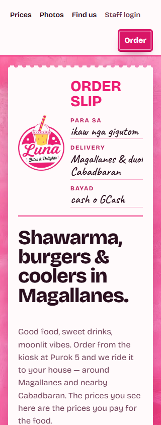
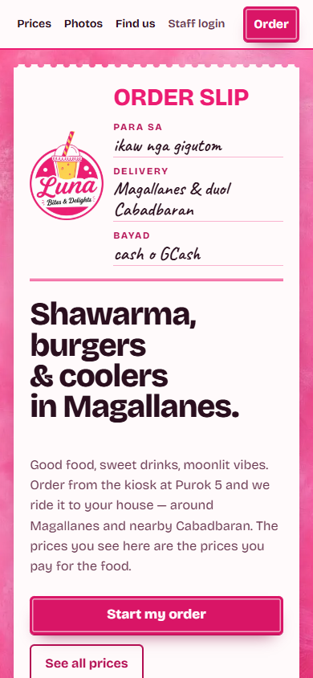
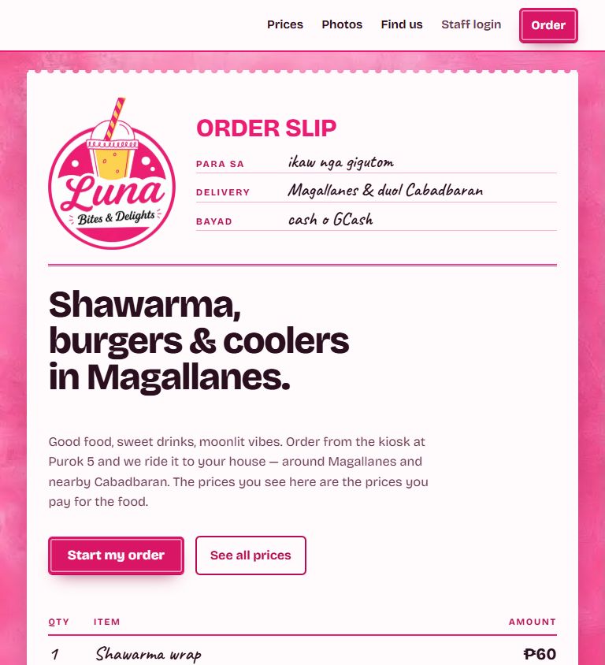
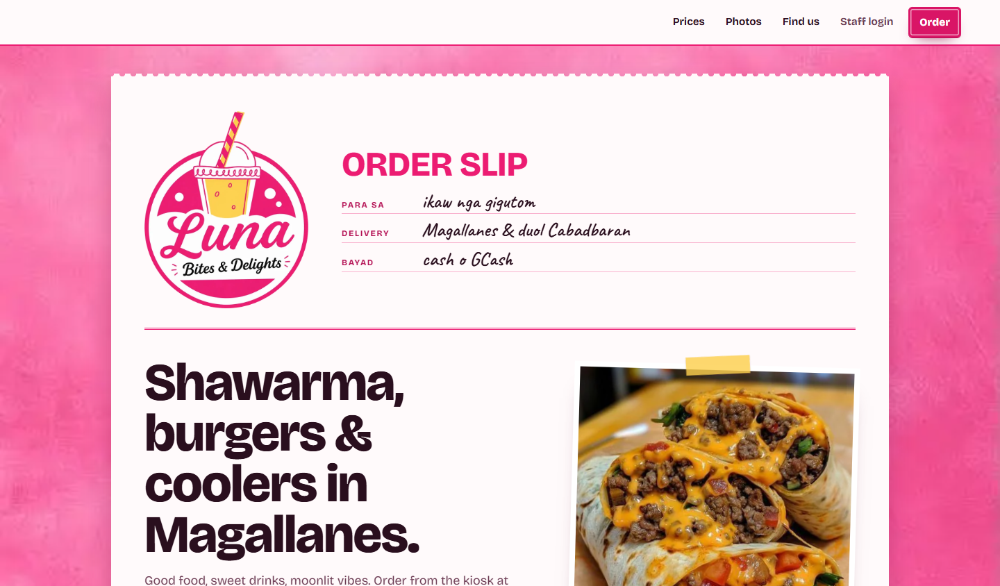
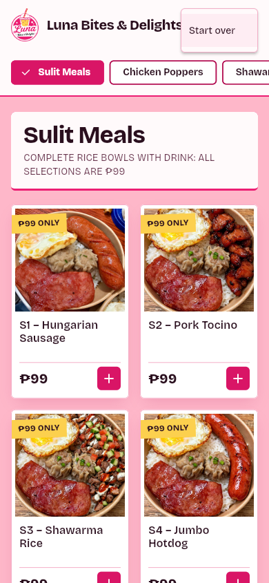
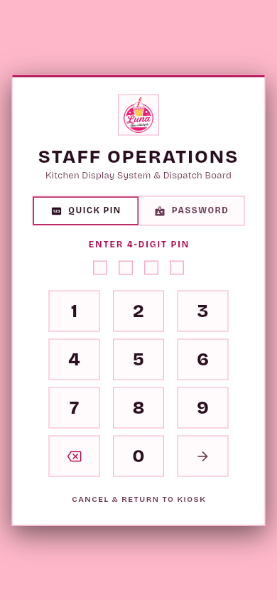

# Staff login moved to the storefront header

Staff sign-in moved off the kiosk and onto the storefront header, beside Find us. The PIN gate at `/kiosk/#/staff` is unchanged.

## What changed

- `site/index.html` and `site/menu/index.html`: a "Staff login" link after "Find us", pointing to `/kiosk/#/staff`.
- `site/styles.css`: the staff link uses the secondary ink colour. Below 460px the header wraps, so the Order stamp drops to its own row instead of squeezing the links. Before this rule, "Find us" and "Staff login" wrapped onto two lines inside 38px and 42px links at 320px.
- `lib/screens/splash_screen.dart`: removed the long-press on the logo, the triple-tap zone in the bottom-right corner, and the helper that opened the login dialog.
- `lib/screens/menu_page.dart`: removed "Staff login" from the overflow menu. "Staff console" still appears for a signed-in staff session. "Start over" is unchanged.

Not changed: the `verifyStaff` function, Firestore rules, the PIN and password flow, and the KDS gate.

## Screenshots

Before: no baseline screenshot was captured. The storefront header before this change had three links (Prices, Photos, Find us). The kiosk had three staff entry points.

Storefront header at 320 px. Order drops to the second row.

Storefront header at 390 px.

Storefront header at 768 px.

Storefront header at 1440 px.

Kiosk overflow menu at 390 px while signed out. Only "Start over" is listed.

"Staff login" on the storefront opens the Staff Operations PIN gate at 390 px.

## Header measurements

Measured in the running page with `getBoundingClientRect`, after the wrap rule was added. Document horizontal overflow was 0 at every width. Every nav link is 44px tall.

| Width | Header height | Order stamp | Links (left to right, px) |
| --- | --- | --- | --- |
| 320 | 112 | second row, top 58, right 304 | Prices 16 to 67, Photos 75 to 131, Find us 139 to 196, Staff login 204 to 283 |
| 390 | 62 | first row, top 8, right 373 | Prices 17 to 68, Photos 76 to 132, Find us 140 to 197, Staff login 205 to 284 |
| 768 | 66 | first row, top 10, right 734 | Prices 335 to 389, Photos 404 to 464, Find us 480 to 541, Staff login 556 to 641 |
| 1440 | 66 | first row, top 10, right 1384 | Prices 965 to 1019, Photos 1041 to 1101, Find us 1123 to 1184, Staff login 1206 to 1290 |

## Checks run

| Check | Command | Result |
| --- | --- | --- |
| Dart format | `dart format --output=none --set-exit-if-changed` on the two changed Dart files | 0 changed, exit 0 |
| Analyzer baseline | `flutter analyze --no-fatal-infos --no-fatal-warnings`, then `node tool/check_analyzer_baseline.mjs` | 87 issues, baseline 87, exit 0. No findings in the two edited files. |
| Flutter tests | `flutter test` | 40 of 40 passed |
| Kiosk web build | `flutter build web --release --base-href /kiosk/` | Built `build/web`, exit 0 |
| Functions build | `npm ci`, then `npm run build` in `functions/` | exit 0 |
| Functions audit | `npm audit --audit-level=high` in `functions/` | exit 0 |
| Firestore rules | `npm run test:rules` with JDK 21 | 8 of 8 passed, exit 0 |
| Rules drift | `npm run check:rules-drift` | Did not complete. Exit 2 because this machine has no Google application default credentials. This PR does not change `firestore.rules`. |

The default `java` on this machine is version 8, which `firebase-tools` rejects. The rules run used the JDK 21 bundled with Android Studio. CI uses Temurin 21.

The build used `--base-href /kiosk/` so the kiosk could be served at `/kiosk/` for the browser checks. CI builds without that flag.

Browser checks used a headless agent-browser session against a local server that serves `site/` with `build/web` copied into `kiosk/`. The session was closed after the checks.

## Staff impact

Staff used to sign in on the kiosk device with a triple-tap in the splash corner, a long-press on the logo, or the overflow menu. Those three routes are gone. Staff now use the "Staff login" link on the storefront, or open `/kiosk/#/staff` directly. The PIN and password checks are the same.

## Found while checking, not changed

`/dashboard`, `/analytics`, and `/lifetime-analytics` are routed in `lib/main.dart` (lines 153 to 155) with no client-side sign-in check. This was already true before this change. The sales data behind the analytics screens comes from `getSalesAnalytics` and `getLifetimeSalesReport`, which call `requireStaff` (`functions/lib/reporting/analytics.js:10` and `functions/lib/reporting/lifetime_report.js:11`). The dashboard lists orders held in memory on the device (`lib/services/order_service.dart:72`). A follow-up should gate those routes.
