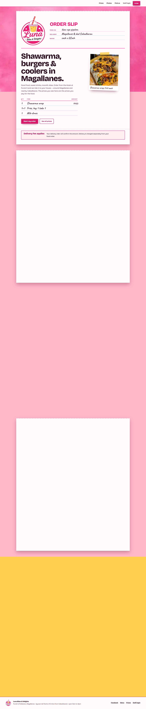
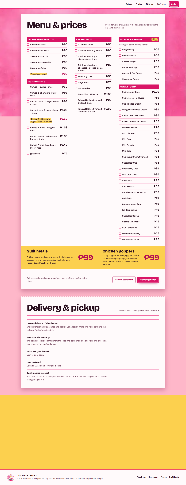
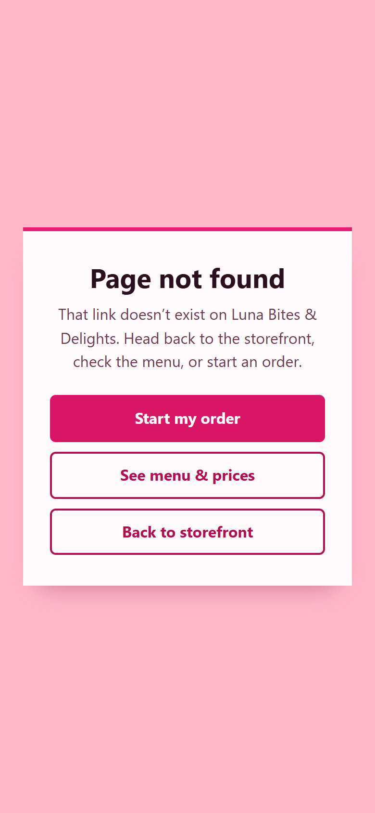

# TypeScript rewrite, step 2: Astro storefront

The storefront (`/`, `/menu/`, `/404.html`, `/payment/*`) now builds from Astro pages in
`app/src/pages/` and prints every price from `app/src/data/menu.ts`. This file shows it looks the
same as before.

## Before and after

Before = the hand-written `site/` pages on `main` (`parity/flutter/`, captured for step 1).
After = the Astro build (`parity/ts/`). Same script, same viewports, same headless Chrome.

| Screen | Before (main) | After (Astro) |
|---|---|---|
| Home, 390 |  |  |
| Home, 1440 |  |  |
| Menu, 390 |  |  |
| Menu, 1440 |  |  |
| 404, 390 |  |  |

All 12 captures (320, 390, 768, 1440 for each page) are in `parity/ts/`.

## Pixel diff

Differing pixels, before vs after, next to a second capture of the same Astro build (run-to-run noise):

| Capture | before vs after | after vs after (rerun) |
|---|---:|---:|
| 404, all four widths | 0 | 0 |
| menu-320 | 0 | 0 |
| menu-390 | 1,355 | 1,355 |
| menu-768 | 1,165 | 1,167 |
| menu-1440 | 992 | 0 |
| home-320 | 360,956 | 358,892 |
| home-390 | 621,584 | 623,754 |
| home-768 | 4,594 | 4,772 |
| home-1440 | 876 | 1,207 |

The page differs from itself between two runs by as much as it differs from `main`. The home-page
noise repeats every 16,384 px down the page (Chrome's tile height for a beyond-viewport capture)
and averages 9.6 of 765 per pixel: anti-aliasing, not a visible change.

## Built HTML vs `site/`

`build/app` against `site/` on `main`, line endings ignored:

- `index.html`: `<!doctype html>` is written `<!DOCTYPE html>`, there is no trailing newline, and the
  58 tick icons serialize `<path …/>` as `<path …></path>`. Every price is the same.
- `menu/index.html`, `404.html`, `payment/*/index.html`: doctype casing and trailing newline only.
- Fonts, images, `robots.txt`, `sitemap.xml`, `llms.txt`, `manifest.webmanifest`: byte-identical
  (moved with `git mv`).

`dart run tool/assemble_site.dart` after a real `flutter build web --release --wasm --base-href /kiosk/`
puts the same 27 files at the root of `build/web` as `main` does.

## Prices

- Each row prints `₱{priceOf(id, variant)}`. `priceOf` throws on an unknown item or variant, so a
  wrong id fails the build.
- `test/site/menu.test.mjs` fails when `menu.ts` and `lib/data/menu_data.dart` differ in any field.
  Checked by changing one price to 96: the test failed, then passed again on revert.
- `test/menu_preselect_test.dart` fails when a row prints the price of a different item than the
  one it marks. Checked by pointing the `s2` row at `s6`: it failed with `row s2 prints the price of s6`.
- This replaces `test/site_price_parity_test.dart`, which compared hand-typed numbers.

## Checks

`docs/evidence/ts-foundation-pr-checks.txt`: every job in `pr-checks.yml`, run locally.

## Reproduce

```bash
npm ci --prefix app && npm run build --prefix app
cd functions && npx firebase-tools emulators:exec --project demo-lunaexpress --only auth,firestore,functions \
  "node ../tool/parity/shoot.mjs --target=ts --only=storefront-home,storefront-menu,storefront-404"
```
