# TypeScript rewrite, step 3: customer ordering

The customer half of the kiosk now exists as Astro pages:
`/kiosk/` (splash), `/kiosk/menu`, `/kiosk/cart`, `/kiosk/checkout`, `/kiosk/map`, `/kiosk/gcash`, `/kiosk/receipt`.
They write the same Firestore order and call the same Functions as the Flutter kiosk. Production still
serves Flutter at `/kiosk/`: `tool/assemble_site.dart` leaves the TypeScript kiosk out of the deployed site
until step 5.

## Before and after

Before = Flutter (`parity/flutter/`, captured in step 1). After = TypeScript (`parity/ts/`).
Same script (`tool/parity/shoot.mjs`), seed data, viewports and headless Chrome, against the emulators.

| Screen | Before (Flutter) | After (TypeScript) |
|---|---|---|
| Splash, 390 |  |  |
| Menu, 390 | 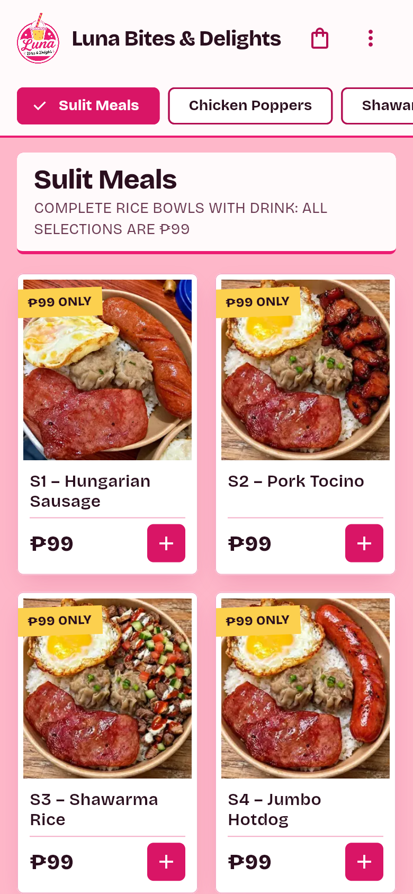 |  |
| Menu, 1440 | 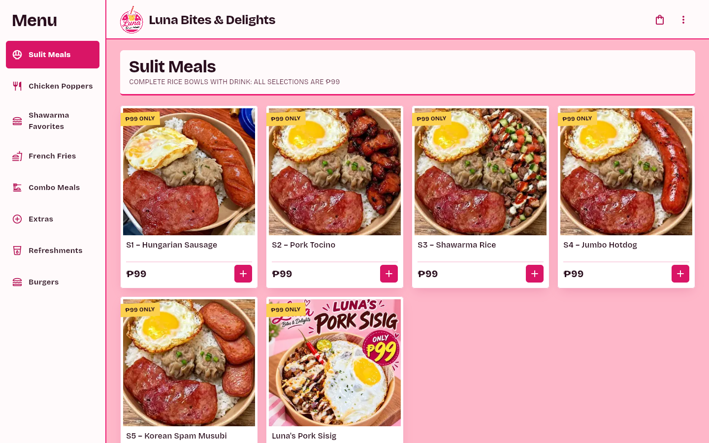 | 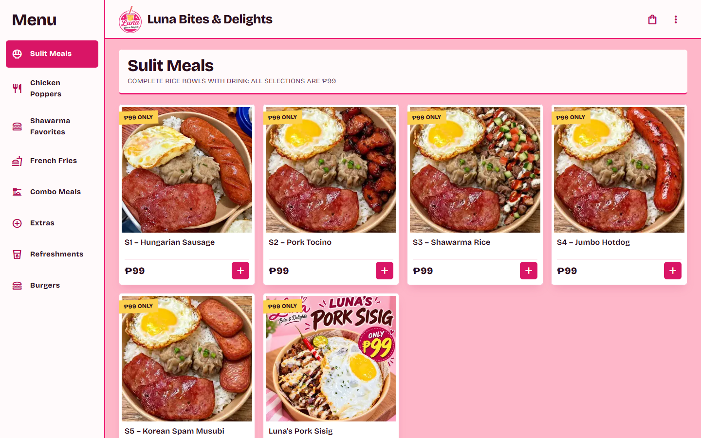 |
| Cart, 390 |  | 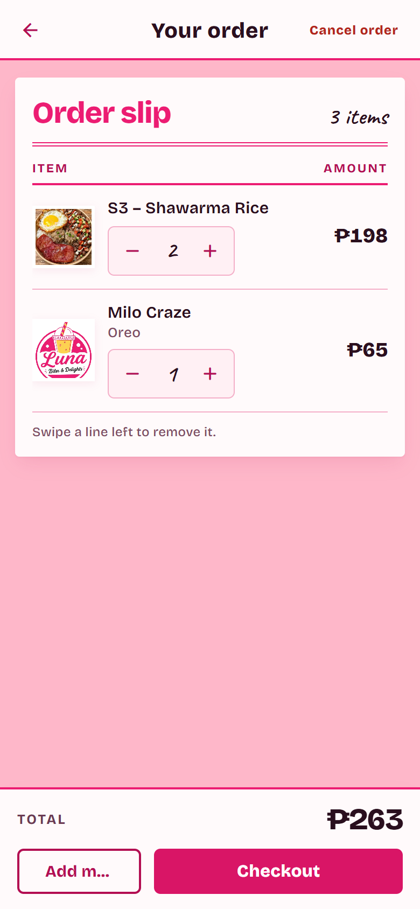 |
| Empty cart, 390 | 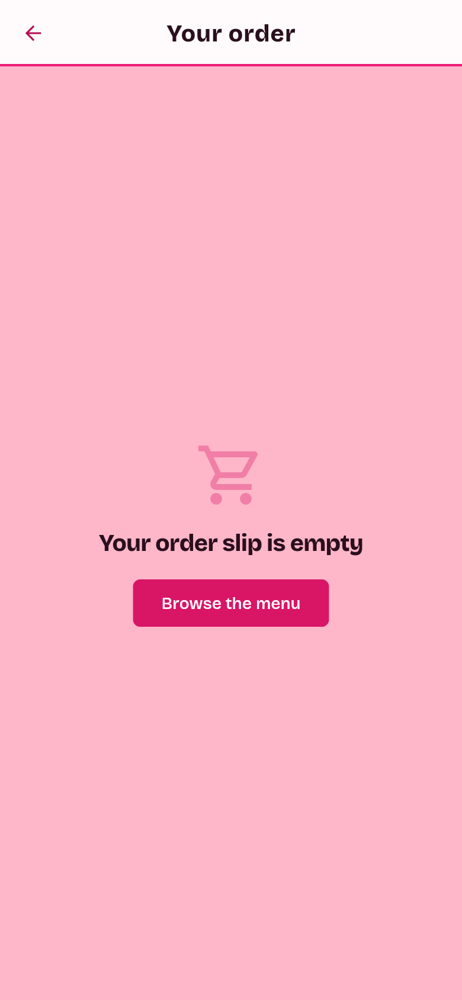 | 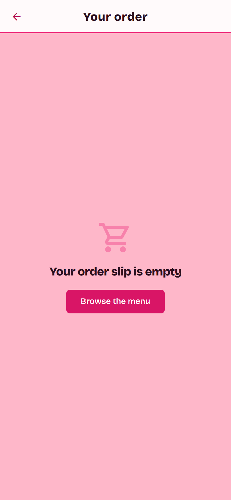 |
| Checkout, 390 | 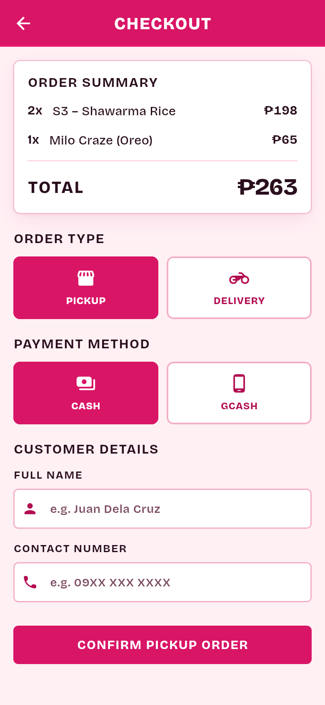 |  |
| Checkout, 1440 | 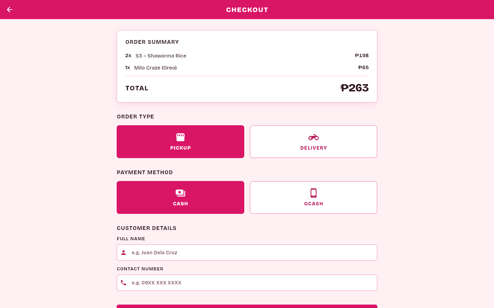 | 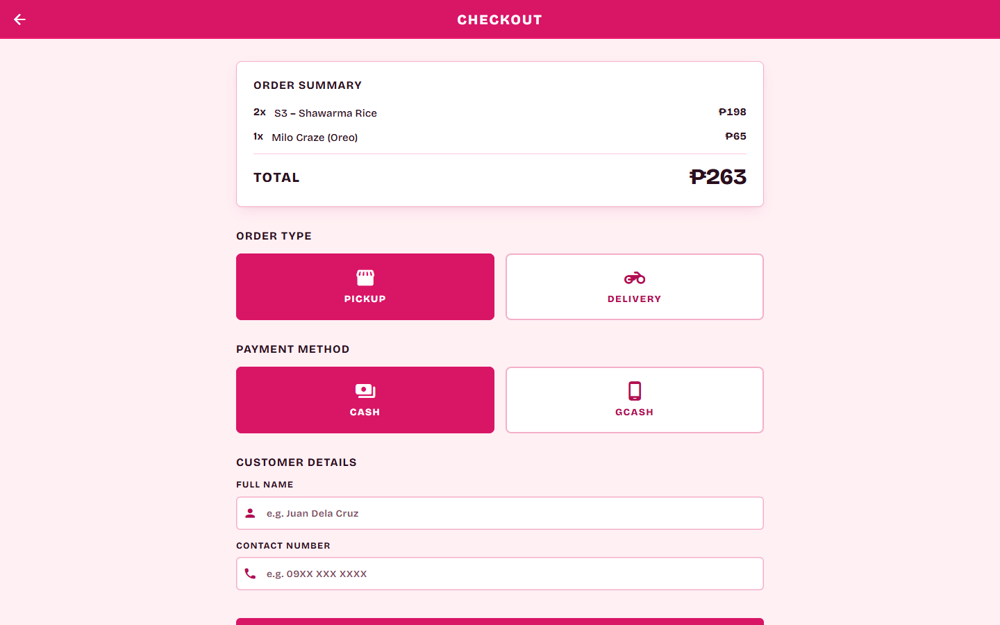 |
| GCash, 390 | 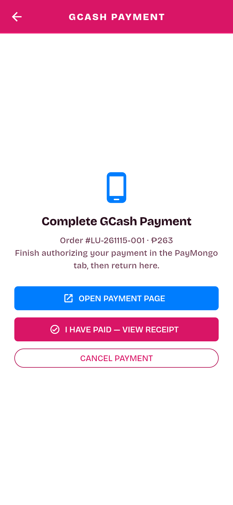 | 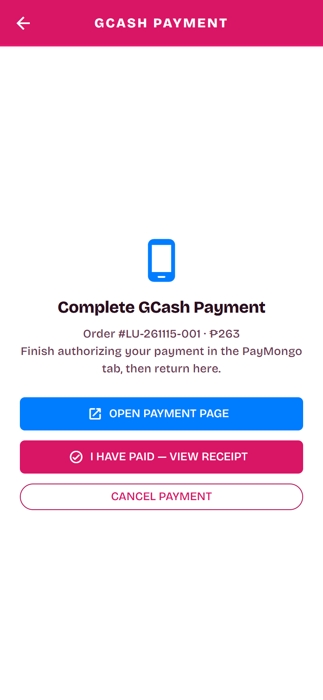 |
| Receipt, 390 | 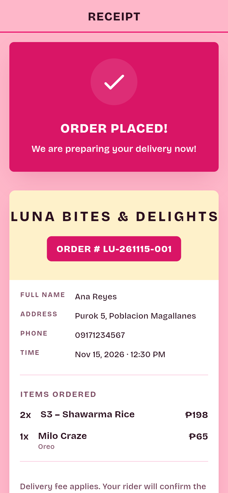 | 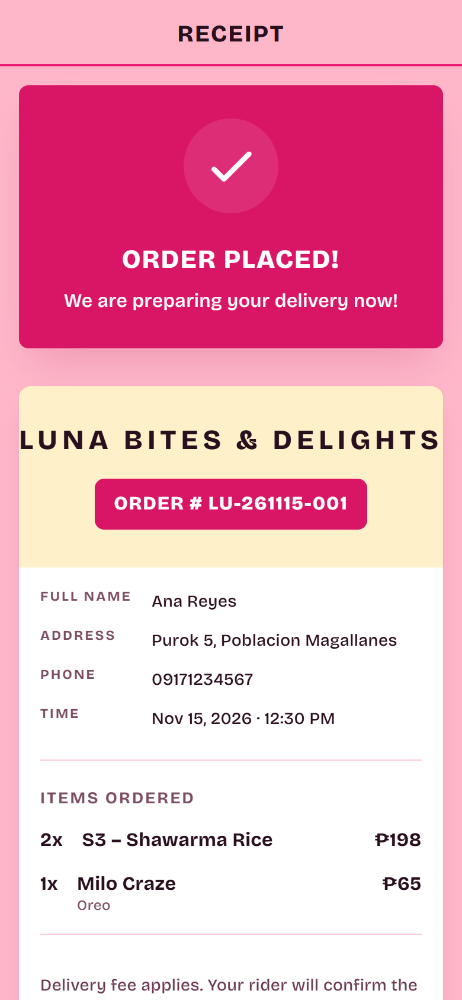 |
| Receipt, 1440 | 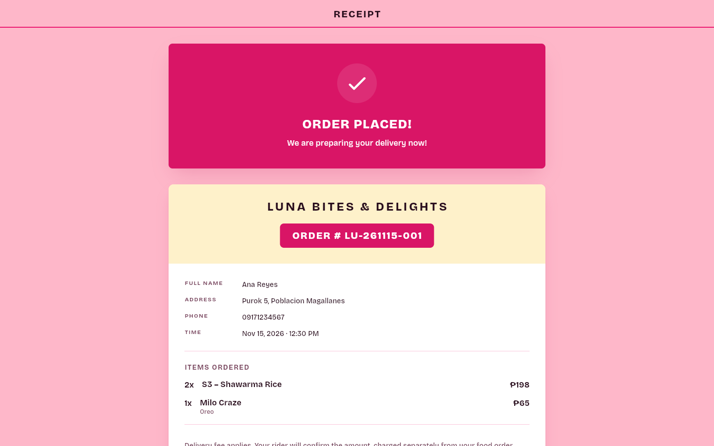 | 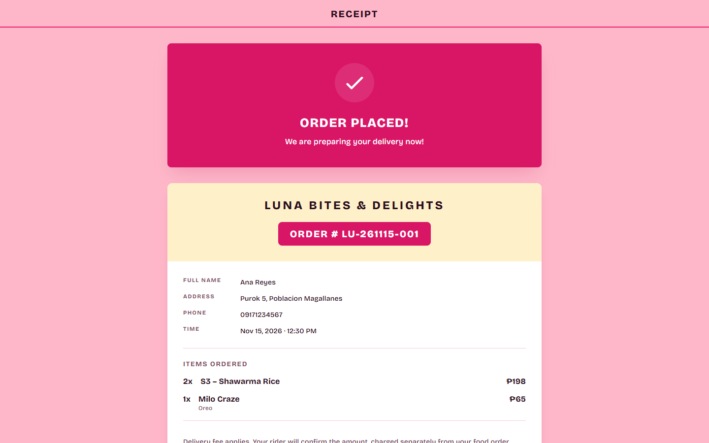 |

All 28 captures (320, 390, 768, 1440 for each screen) are in `parity/ts/`.

### TypeScript only

Flutter's preview harness cannot open these, so there is no baseline image. Both follow
`lib/screens/map_picker_page.dart` and the checkout delivery state in `checkout_page.dart`.

| Delivery checkout, 390 | Map picker, 390 |
|---|---|
| 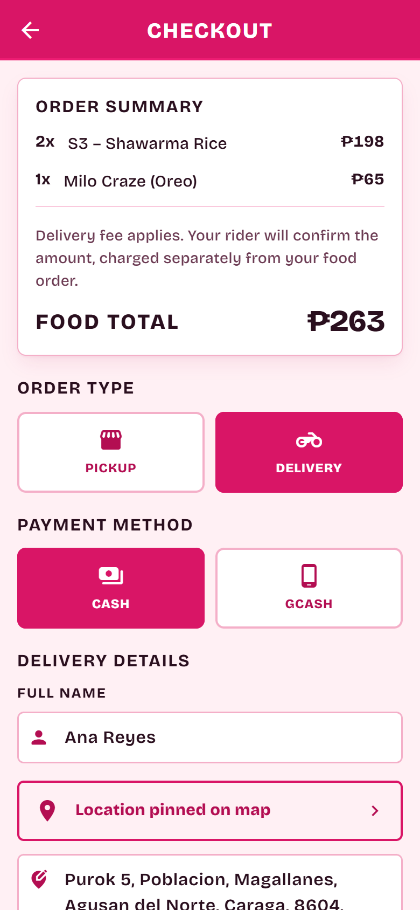 | 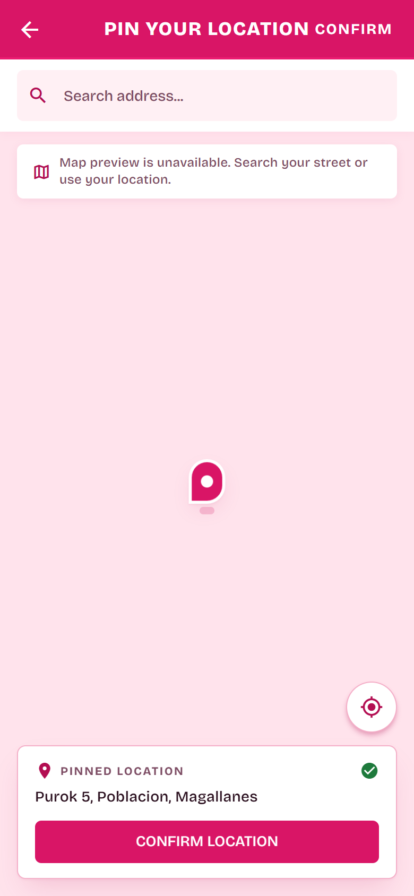 |

The map was captured with no MapTiler key built in, so it shows Flutter's "Map preview is unavailable"
notice in place of tiles. With `PUBLIC_MAPTILER_KEY` set, Leaflet draws MapTiler streets-v2 tiles and
shows the attribution line that MapTiler and OpenStreetMap require.

## Pixel diff

Pixels whose RGB difference is above 30, Flutter vs TypeScript, out of the whole capture:

| Screen | 320 | 390 | 768 | 1440 |
|---|---:|---:|---:|---:|
| splash | 8.5% | 4.6% | 2.0% | 1.4% |
| menu | 14.1% | 8.1% | 3.9% | 5.7% |
| cart, empty | 0.7% | 0.4% | 0.3% | 0.3% |
| cart | 6.9% | 4.1% | 1.8% | 1.3% |
| checkout | 3.8% | 3.9% | 2.7% | 2.0% |
| receipt | 3.6% | 4.3% | 2.9% | 1.8% |
| gcash | 3.5% | 2.2% | 1.0% | 1.0% |

What differs:

- **Text rasterisation.** Browser text and Flutter's text engine antialias glyph edges differently. Glyphs
  land within 1–2px of each other, so most of the red in a diff is outlines of the same text. The menu
  has the most text, so it scores highest.
- **Splash motion.** The logo float, dot fade and button pulse are mid-animation when the capture
  fires, and the two runs are at different points in the loop.
Copy, colours and layout match. Where an element sits differently, it is off by 1–2px.

## End to end: real orders on the emulators

`tool/parity/order_e2e.mjs` builds nothing itself. It drives the emulator build
(`PUBLIC_FIREBASE_EMULATORS=1 npm run build`) in headless, muted Chrome. A shopper with two items
in the cart picks the order type, types a name and phone, and taps the confirm button. The page writes
the order to the Firestore emulator through the real `firestore.rules`, calls `sendOrderNotification`
on the Functions emulator, and lands on the receipt. The script then reads the order back with
the Admin SDK. Full output: [`ts-kiosk-order-e2e.json`](ts-kiosk-order-e2e.json).

| Run | Button | Reached receipt | Saved order |
|---|---|---|---|
| Pickup, cash | CONFIRM PICKUP ORDER | yes, 0.2 s | `type: Pickup`, `customerAddress: Pickup`, `paymentStatus: NOT PAID`, `entryType: Kiosk`, 2 lines, `totalAmount: 263` |
| Delivery, cash (pinned) | PLACE DELIVERY ORDER | yes, 0.2 s | `type: Delivery`, `lat: 9.0212`, `lng: 125.5181`, `totalDistance: 0.13`, the pinned address, `totalAmount: 263` |

Each order's line items carry a `total`, and `checkoutSessionId` and `paymongoPaymentId` are null, as
Flutter's `OrderModel.toJson` writes them. Afterwards the cart is empty and the checkout draft is
cleared.

The emulator has no Telegram bot secrets, so `sendOrderNotification` answers 500 and sets
`telegramSent: false` on the order. The receipt then shows Flutter's orange "Order saved! Telegram
notification could not be sent" snackbar. That is the failure path working as designed: the order is
saved before the notification is tried.

| Pickup receipt | Delivery receipt |
|---|---|
| 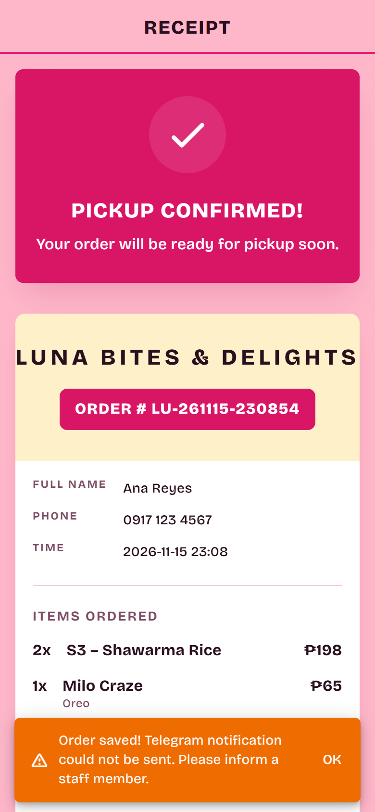 | 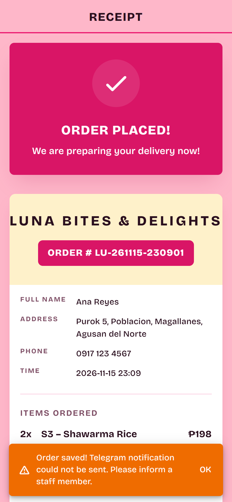 |

GCash was not run end to end: it needs PayMongo. The GCash screen is covered by the parity capture,
which answers `createCheckoutSession` in the page. The verify and cancel paths port
`gcash_checkout_page.dart` line for line.

## Unit tests

`test/site/kiosk.test.mjs` (part of `npm run test:site`, which CI runs) checks the TypeScript rules
against the Flutter ones:

- storefront picks (`test/menu_preselect_test.dart`'s exact case)
- the cart (merge, totals, persistence)
- order statuses `firestore.rules` accepts
- name and PH phone validation
- PHT order numbers and date labels
- delivery distance from the nearer kitchen
- the saved order and notification payloads

38 of 38 site tests pass. Local `pr-checks.yml` run: [`ts-ordering-pr-checks.txt`](ts-ordering-pr-checks.txt).
